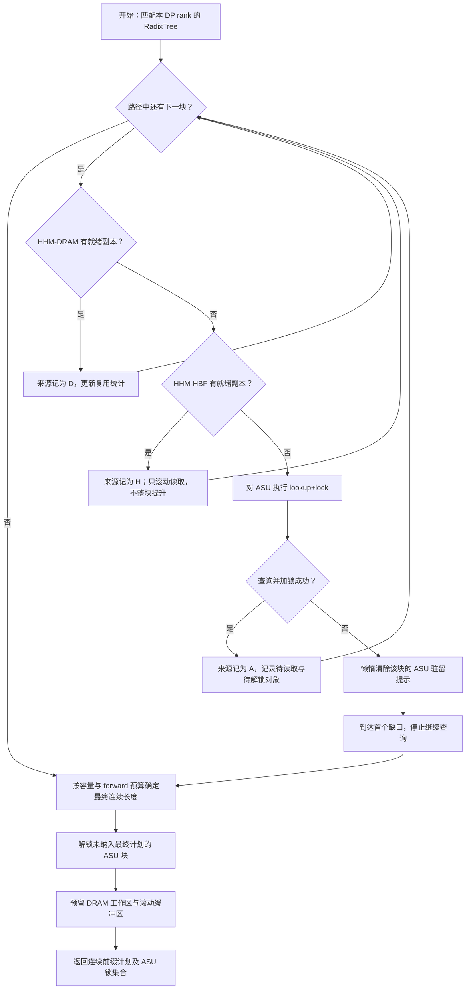
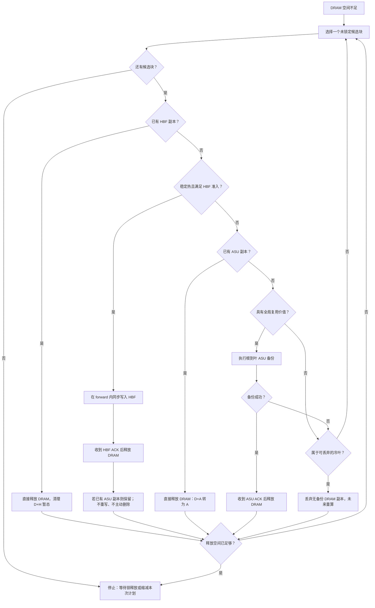
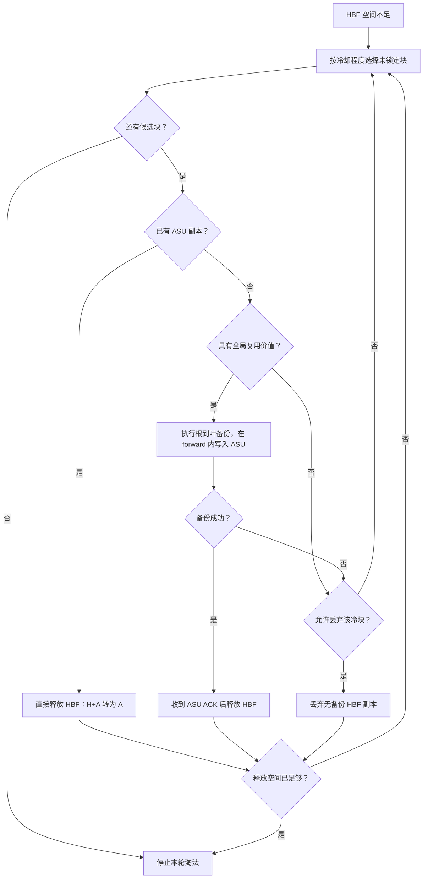
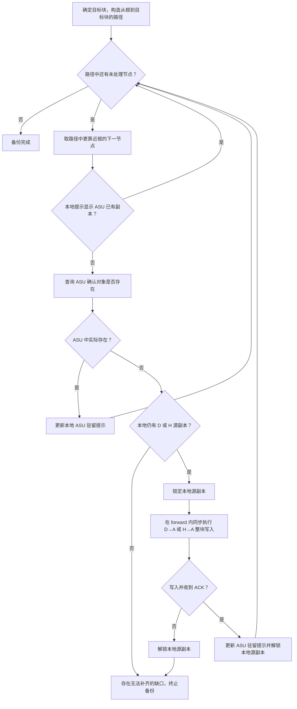

```
我们发现该系统与现有系统有几个不一样的点：
1. 互联域不同：HHM是每卡独有，ASU是全局共享。这一点和hicache的HBM+DRAM+SSD最像，唯一的差别是DRAM这一层是机内共享的，而HHM-HBF则是卡内独享的。不过hicache的DRAM这一层本身也不会跨卡复用，所以软件上可能刚好一样了。
2. 互联方式不同：仅仅允许 HHM-DRAM <-> HHM-HBF, HHM-DRAM <-> ASU, HHM-HBF <-> ASU 这三种南北向数据通路，数据不允许走P2P东西向通路（但是控制信号还是可以走的）。
3. ASU这一层其实是一种类似nvidia ICMS的高带宽、高IOPS、全局池化的KV语义存储层，可以抽象为具有5种基本操作：
     - lookup: 查询一个Key是否存在
     - lock/unlock: 要使用一个key之前，先锁住，避免它在使用时ASU内部的自动淘汰算法把它淘汰了。unlock则是解锁。
     - read: 指定key，读取value(也即kvcache block数据)，会直通到NPU HHM上
     - write: 指定key，写value，同样会直通。注意这里读写的单位都是整个KV block ，不允许部分写
     - delete: 指定key，主动删除它，腾出空间（另外ASU内根据自身剩余容量，也会主动淘汰掉一些block，淘汰算法是LRU）
     - 以上操作也可能组合出一些合并的原子操作，比如 lookup+lock 原子操作
   需要注意区分 "KV语义" 和 "KVcache" ，KV语义是指由指定的Key，可以lookup/lock/unlock/read/write/delete特定的Value，只不过这个Value存的实际上是kvcache block。而kv语义的key可以是kvcache的token hash+position


此外，我们针对KVC管理系统还给出这几个原则：
1. 算传同步：为了设计简单，所有的前缀缓存在数据面的传输（包括promote和demote）都必须和model.forward一起走，也即同步执行（可跨层掩盖），但是不能异步执行。
2. 命中率原则：
     - HHM命中率越高越好。在HHM内部，命中HBF和命中DRAM是一样的（因为HBF命中可以通过滚动加载消除其影响，对性能没有任何影响）
     - ASU命中率越高越好。如果一个块没有命中 HHM ，就看 ASU有没有命中。ASU命中相比HHM命中有特定的性能损失，但总比完全没命中要好
3. 降写原则：HHM-HBF和ASU都有特定的写寿命，应该尽量少写。其中HHM-HBF的寿命问题更严重一些。
```


# HHM＋ASU 原生 KVC 管理系统：方案抽象与算法设计

> 设计对象：面向 HHM＋ASU 硬件的前缀 KV cache 管理系统。  
> 设计蓝本：继承 HiCache 的“每 DP rank 本地 RadixTree”思路，但重新设计共享域、数据通路、命中流程、写入准入和三级淘汰。  
> 基本部署假设：一个 DP rank 对应一张 NPU；若启用 TP，则由同一 TP 组协调前缀长度，每个 TP rank 管理自己的 KV 分片。EP 域不构成额外的 KV cache 共享边界。

## 一、设计目标与硬件约束

### 1.1 硬件能力

每张 NPU 的本地存储与全局存储抽象如下：

| 层级 | 本文符号 | 容量与带宽 | 软件共享域 | 主要角色 |
|---|---|---|---|---|
| HHM-DRAM | $C_D$ | 36 GB 物理容量，24 GB 可用，3.2 TB/s | 每卡私有 | 活动工作集、新 KV 落点、HBF／ASU 的层内滚动缓冲 |
| HHM-HBF | $C_H$ | 320 GB，800 GB/s | 每卡私有 | 稳定、长寿命前缀的本地容量层 |
| ASU | $C_A$ | 全局池化；容量与有效带宽作为部署参数 | 全局共享 | 跨 DP rank、跨节点复用，以及全局 KV 语义存储 |

HHM-DRAM 与 HHM-HBF 合封在同一颗 NPU 的 HHM 内。本文把二者视为不同的物理驻留层，但在命中率指标上统一计为 **HHM 命中**。

### 1.2 数据通路约束

只允许以下三种南北向数据通路：

$$
C_D\leftrightarrow C_H,\qquad
C_D\leftrightarrow C_A,\qquad
C_H\leftrightarrow C_A .
$$

不允许 KV 数据走卡间或节点间 P2P 东西向通路；控制信号仍可跨卡、跨节点传输。因此：

- 跨 DP rank 复用必须经过 ASU，不能直接从另一张卡的 HHM-DRAM 或 HHM-HBF 拉取。
- ASU 命中可直通本卡 HHM；默认进入 HHM-DRAM 的滚动缓冲区，而不是一命中就写入 HHM-HBF。
- HHM-HBF 不应成为 ASU 的必经中转层，否则会增加 HBF 写入并加剧寿命压力。

### 1.3 ASU 的 KV 语义

ASU 不是另一棵全局 RadixTree，而是一个支持 KV 语义操作的全局对象层：

| 操作 | 语义 | 在本方案中的用途 |
|---|---|---|
| `lookup(key)` | 查询 key 是否存在 | 从首个本地未命中块开始，顺序探测 ASU 前缀 |
| `lock(key)`／`unlock(key)` | 防止使用中的对象被 ASU 自动淘汰 | 锁住本次准备读取的连续前缀，读完后释放 |
| `read(key)` | 原子读取整个 KV block | 在 `model.forward` 内读取到本卡 HHM |
| `write(key, value)` | 原子写入整个 KV block | 在 `model.forward` 内备份完整、不可变块 |
| `delete(key)` | 主动使对象失效 | 用于显式失效或管理操作，不作为普通本地淘汰的固定动作 |

建议补充两种复合原子操作：

- `lookup+lock`：消除“lookup 成功、lock 前已被 LRU 淘汰”的竞态。
- `write_if_absent`：多个 DP rank 同时备份相同前缀时避免重复写入；若没有该操作，应由 ASU 内部按 key 去重。

这里的 **KV 语义** 指 key→value 的查找、保护、读写和删除接口；value 恰好是不可变的 KV cache block，并不意味着 ASU 需要理解 RadixTree。

### 1.4 设计原则

1. **算传同步。**所有 promote、demote、备份和淘汰引起的数据面传输，都必须伴随一次 `model.forward` 同步发起并完成，可跨层流水掩盖，但不能由后台线程异步搬迁。
2. **先 HHM、后 ASU。**HHM-DRAM 与 HHM-HBF 命中都优先于 ASU；在给定“HBF 可滚动加载且命中不损失性能”的前提下，二者对命中目标等权。
3. **减少写入。**HHM-HBF 的写寿命约束强于 ASU，应优先减少 HBF 的重复写、短期写和往返搬运；ASU 也应避免无复用价值的写入。
4. **连续前缀。**无论从哪一层取数，请求可见的命中都必须从第一个 block 开始连续，不能跳过中间缺口使用后续块。
5. **本地提示而非全局强一致。**各 DP rank 的 RadixTree 只保存自身视角的驻留提示；ASU 的实际存在性以最近一次 `lookup` 或 `lookup+lock` 为准。

## 二、总体架构抽象

### 2.1 三级缓存的角色分工

```text
DP rank 0：本地 RadixTree                DP rank 1：本地 RadixTree
          │                                       │
   NPU 0：C_D ⇄ C_H                      NPU 1：C_D ⇄ C_H
             ⇅   ⇅                                  ⇅   ⇅
             └───┴──────────  ASU  ────────────────┴───┘
                    全局 KV 语义、独立目录、内部 LRU

禁止：NPU 0 的 C_D/C_H ⇄ NPU 1 的 C_D/C_H 直接传数据。
```

三级并非传统意义上简单的“越往下越冷”：

| 层级 | 应保存的对象 | 不应承担的角色 |
|---|---|---|
| $C_D$ | 寿命最短的活动 KV、新产生或尚未填满的块、滚动读缓冲，以及等待复用观察的完整块 | 长期保存所有稳定前缀；容量不足时无差别堆积 |
| $C_H$ | 经 DRAM 的时间窗 LRU 与复用统计证明会长期复用的稳定热前缀 | 每个 ASU 命中块的默认写入地；频繁换入换出的临时缓存 |
| $C_A$ | 有跨请求或跨 DP rank 复用价值的完整块、P→D 等明确跨端事务的数据 | 由某个 DP rank 强一致维护的全局 RadixTree；无差别保存所有瞬时块 |

因此，$C_D$ 同时是 $C_H$ 的**观察与准入层**：新块先在这里经历一段时间窗的 LRU 观察，频繁复用者迁移到 HBF，否则按全局复用价值写入 ASU 或直接丢弃。$C_D$ 到 $C_H$ 是**稳定化迁移**，$C_H$ 到 $C_A$ 则是以冷却和全局复用为目标的撤离。

### 2.2 副本状态：本地互斥、全局选择性重叠

为了减少本地双份占用和无效 HBF 写入，稳态应以 $D$、$D+A$、$H$、$A$ 为主：

| 状态 | 定位 | 使用规则 |
|---|---|---|
| $D$ | **正常稳态** | 新块、短寿命块和仍在接受复用观察的块 |
| $D+A$ | **允许稳态** | ASU 已有全局备份，但 DRAM 副本仍在服务请求或接受 HBF 准入观察 |
| $H$ | **正常稳态** | 稳定热块的本地长期驻留状态 |
| $A$ | **正常稳态** | 本地副本已释放，仅保留全局副本和元数据提示 |
| $D+H$ | **仅限迁移暂态** | 只存在于 $D\rightarrow H$ 写入窗口；HBF ACK 后在同一个 `forward` 内释放 D |
| $H+A$ | **非目标状态** | 不由 HBF 主动复制到 ASU 后保留 H 产生；仅允许迁移暂态或从 $D+A$ 晋升时继承的例外 |
| $D+H+A$ | **仅限迁移暂态** | 只可能出现在 $D+A\rightarrow H$ 的写入窗口，随后立即释放 D |
| $\varnothing$ | **无副本** | 后续需要重算 |

相应的状态迁移为：

```text
新块 → D
D ──全局备份──→ D+A
D ──稳定热准入──→ H                 # D+H 仅是迁移暂态
D ──冷却且无全局价值──→ ∅
D+A ──冷却并释放本地副本──→ A
D+A ──稳定热准入──→ H+A              # 继承已有 A，不重复写、不主动删除 A
H ──冷却并备份 ASU──→ A             # H+A 仅是迁移暂态
H／A ──淘汰──→ ∅
```

不强制 $C_D\subseteq C_H\subseteq C_A$，但**本地 D／H 在稳态下互斥**，ASU 与本地只允许选择性重叠。需要特别注意：若 $D+A$ 后来满足 HBF 准入，直接晋升会继承为 $H+A$。此时不应为了消除重叠而主动 `delete(A)`，因为 ASU 副本可能正被其他 DP rank 使用；应允许该例外自然等待 ASU LRU 淘汰，或在以后 HBF 冷却时释放 H。策略真正禁止的是**主动从 H 复制到 A 后仍长期保留 H**。

### 2.3 命中指标

对一个请求需要的前缀 block 总数 $N$，按实际取数来源定义：

- $N_D$：HHM-DRAM 命中数；
- $N_H$：HHM-HBF 命中数；
- $N_A$：本地未命中、但 ASU 命中数；
- $N_M$：完全未命中、必须重算的 block 数。

则：

$$
N=N_D+N_H+N_A+N_M,
$$

$$
\eta_{\mathrm{HHM}}=\frac{N_D+N_H}{N},\qquad
\eta_{\mathrm{ASU}}=\frac{N_A}{N},\qquad
\eta_{\mathrm{total}}=\frac{N_D+N_H+N_A}{N}.
$$

优化顺序是：先提高 $\eta_{\mathrm{HHM}}$，再提高 $\eta_{\mathrm{ASU}}$，同时约束 HBF／ASU 写放大和 `forward` 内的传输时间。

## 三、对象、键与本地元数据

### 3.1 不可变 KV block

为同时满足“整块读写”和“降低写次数”，建议采用以下规则：

1. block 按固定 token 数切分；只有填满并封口的完整块才能写入 $C_H$ 或 $C_A$。
2. 尚未填满的 decode 尾部块只留在 $C_D$，继续追加，不对下级层反复覆盖写。
3. 完整块一旦封口即不可变；不同内容必须对应不同 key，禁止原地更新。
4. 为支持跨层流水，物理 value 宜按“token block × layer group”组织。若一个 value 包含所有层，则只能在首层计算前整块读取，无法细粒度地跨层掩盖。

### 3.2 前序 hash-chain 与 ASU key

仅使用“token hash＋position”不足以避免不同上下文的冲突。建议采用前序链：

$$
\begin{aligned}
p_0 &= H(\mathrm{model\_rev},\mathrm{kv\_layout},\mathrm{cache\_salt}),\\
p_i &= H(p_{i-1},\mathrm{token\_block}_i),\qquad i=1,\ldots,n,\\
k_{i,g} &= H(p_i,i,g,\mathrm{shard\_layout}).
\end{aligned}
$$

其中：

- $i$ 是 token block 的位置，$g$ 是 layer group；
- `model_rev`、`kv_layout` 和 `cache_salt` 防止不兼容缓存误复用；
- `shard_layout` 描述 TP 等物理分片方式，可以包含分片位置，但**不能包含 DP rank 标识**，否则相同前缀无法跨 DP rank 去重；
- 不同 DP rank 只要模型、布局和前缀内容相同，就能独立推导出相同 key。

### 3.3 每 DP rank 的 RadixTree

每个 DP rank 维护自己的 RadixTree，不维护全局树。节点除 token 路径外，建议保存：

| 字段 | 含义 |
|---|---|
| `prefix_key / block_pos / layer_group` | 推导 ASU key 所需的信息 |
| `residency` | 每个物理块在 $D/H/A$ 的驻留位图 |
| `ptr_D / ptr_H` | 本地 DRAM／HBF 地址或块句柄 |
| `asu_state` | `UNKNOWN／PRESENT／ABSENT／LOCKED`；只是提示，不是全局权威状态 |
| `lock_ref` | 当前请求或正在进行的同步传输是否保护该节点 |
| `last_access / reuse_count / distinct_requests` | 本地冷热与稳定复用统计 |
| `stable_score` | 是否适合长期驻留 HBF 的综合评分 |
| `write_count_H / write_count_A` | 识别反复写入与缓存抖动 |
| `children / parent` | 本地前缀结构、叶优先释放与元数据修剪 |

RadixTree 节点可以只保留元数据而没有 HHM 数据，例如该块仅存于 ASU。这样，本地树仍然是该 DP rank 的私有前缀目录，但不要求每个树节点都对应本地物理副本。

### 3.4 ASU 删除后的懒惰更新

ASU 自己执行 LRU，其他推理实例也可能显式 `delete`，所以本地 `PRESENT` 提示可能过期。处理规则为：

1. 需要使用该块时执行 `lookup+lock`。
2. 若返回 miss，清除该节点的 ASU 驻留位，并将其标为 `ABSENT`；不要继续假设后续块形成可用 ASU 前缀。
3. 若节点仍有 $D/H$ 副本，**只清除 ASU 提示，不删除整个 RadixTree 节点**。
4. 只有当节点没有任何 $D/H/A$ 副本、没有锁且是叶节点时，才删除该元数据节点，并递归修剪失去孩子的空父节点。
5. `ABSENT` 不能永久缓存，因为其他 DP rank 之后可能重新写入；可在后续请求重新探测，或使用很短的负缓存 TTL。

## 四、命中查询与算传同步

### 4.1 统一查询流程

命中不能先分别计算“HHM 前缀”和“ASU 前缀”再简单相加，因为实际前缀可能混合来源，例如根块在 ASU、后续块在 HBF。应逐块构造连续计划：



流程要点：

1. **本地优先。**每块先查 DRAM，再查 HBF；二者都命中 HHM，但 HBF 命中不做整块 DRAM 晋升。
2. **按需查询 ASU。**只有本地未命中才执行 `lookup+lock`，成功后才把该块纳入计划。
3. **缺口即停止。**任何一块在 D、H、A 都不可用，就停止查询，后续块不能计入连续前缀。
4. **统一收口。**最后根据容量和 `forward` 传输预算确定可用长度，解锁多余对象，并预留滚动缓冲区。

如果只能分别调用 `lookup` 和 `lock`，则 lock 失败时必须重查或停止，不能把此前的 lookup 结果当作仍可读取的保证。

### 4.2 `model.forward` 内的数据面执行

设当前计算第 $g-1$ 个 layer group，则可为第 $g$ 组准备数据：

| 来源 | 数据面动作 | 驻留状态是否改变 |
|---|---|---|
| $C_D$ | 直接引用已就绪 KV | 不变 |
| $C_H$ | 滚动执行 $C_H\rightarrow C_D$ 的层组缓冲读取 | 默认不变，不产生整块 DRAM 晋升 |
| $C_A$ | 滚动执行 $C_A\rightarrow C_D$，读取已 lock 的对象 | 默认只保留临时 DRAM 缓冲，不写 HBF |
| 未命中 | 正常计算新 KV，并先写入 $C_D$ | 新完整块初始为 $D$，未满块不共享 |

`forward` 返回前必须完成本次计划内的数据传输，并释放不再需要的 ASU lock；异常路径也必须通过 `finally` 语义解锁。不能在请求结束后遗留后台 promote／demote。

### 4.3 同步流水预算

若希望缓存读取不显著拉长 step time，应满足近似条件：

$$
T_{\mathrm{data}}(\mathrm{plan})\leq T_{\mathrm{compute}}(\mathrm{plan}),
$$

其中 $T_{\mathrm{data}}$ 必须包含 HBF 读取、ASU 读取、DRAM 缓冲写入和共享接口争用。该条件需要通过实测分层标定，不能仅根据峰值带宽相除得出结论。

当计划超出容量或传输预算时，应缩短 ASU 命中范围并重算余下部分，而不是把传输转成后台任务。每个 `forward` 可设置最大 HBF／ASU 读写字节数，避免一次大批量淘汰阻塞整步计算。

## 五、写入与准入策略

### 5.1 默认写入路径

```text
新 KV 产生
   │
   ▼
HHM-DRAM：活动副本＋复用观察
   │
   ├─ 未满／仍在追加：只留 DRAM
   │
   ├─ 完整且稳定热：迁移 D→H，HBF ACK 后立即释放 D
   │
   ├─ 有全局复用价值：按根到叶备份 D→A，允许保留为 D+A
   │
   └─ 冷却且无全局复用价值：直接丢弃，未来重算
```

核心规则：

1. **DRAM 是观察与准入层。**新块先只写 DRAM，通过时间窗 LRU、复用次数和不同请求数观察其寿命，再决定 HBF／ASU 准入。
2. **本地 D／H 稳态互斥。**$D\rightarrow H$ 采用 迁移语义，$D+H$ 只存在于写入与 ACK 的短暂窗口，不作为长期缓存策略。
3. **HBF 命中不写 DRAM 整块副本。**只使用滚动缓冲，避免 DRAM↔HBF 往返。
4. **ASU 命中不默认写 HBF。**读取后先进入 DRAM 观察；只有后续统计证明其属于稳定热前缀，才在同步维护窗口中准入 HBF。
5. **写前查重。**写 ASU 前先 lookup，优先使用 `write_if_absent`；HBF 由本地驻留位图保证同一块不重复写。
6. **不在 decode 每 token 后写下级。**只有块填满并封口后才具备 HBF／ASU 写入资格。

### 5.2 HBF：稳定热块准入

“把热块从 DRAM 淘汰到 HBF”应细化为：**把经过 DRAM 观察、被频繁复用且未锁定的完整块迁移到 HBF，并在 HBF ACK 后立即释放 DRAM 副本。**是否触发迁移可以由 DRAM 容量压力驱动，也可以由稳定热阈值驱动，但不能长期保留 $D+H$ 双份副本。

稳定热不等于当前瞬时最热。建议至少满足：

- 已被多个不同请求复用，而非一次请求内部的短期突发；
- 在较长时间窗口内持续复用，或属于已知长寿命系统前缀；
- 当前未被计算或传输锁定；
- 不在 HBF 写入后的冷却期，也不是刚从 HBF 读出的临时副本。

这样做的目的，是让 HBF 形成低 churn 的稳定集合：写入一次后长期被读，而不是随着短期 LRU 波动反复换入换出。活跃计算块即使很热，也应继续留在 DRAM，直到不再被锁定。

若源状态是 $D+A$，晋升 HBF 时只写 HBF，不重写 ASU，也不主动删除 ASU 副本；结果暂时为 $H+A$。这是为保留本地 HHM 命中而接受的继承例外，而不是常规备份路径。

### 5.3 ASU：选择性全局备份

ASU 虽然共享，但也不应成为所有本地淘汰块的无条件写入地。建议按以下条件准入：

- 完整、不可变且能推导确定性的前序 key；
- 有跨请求、跨 DP rank、跨节点或明确 P→D 消费者的复用价值；
- 从根到当前块的祖先已经在 ASU，或能够在本次同步窗口中按顺序补齐；
- 当前不存在相同 key，且未处于反复写入冷却期。

从 DRAM 备份到 ASU 后，允许形成 $D+A$：A 提供全局复用，D 继续服务本地请求并接受 HBF 准入观察。DRAM 是否释放由容量压力和冷热状态另行决定，不与 ASU 写入绑定。

从 HBF 备份到 ASU 则采用 迁移语义：只有 HBF 块已经冷却并需要撤离时才写入 ASU，ACK 后释放 H，不主动形成长期 $H+A$。纯粹一次性、很快过期的本地块可以直接丢弃；缓存允许丢失，正确性由重算保证。

## 六、三级淘汰算法

### 6.1 总体原则

三级淘汰需要同时回答三个问题：

1. **释放哪一层的空间？**
2. **是否值得为对象写下级副本？**
3. **以什么顺序维护跨 DP rank 可复用的连续前缀？**

建议采用：

- DRAM：稳定热块优先迁移 HBF；已有 ASU 副本的冷块直接释放 D；其余块再按全局价值选择 ASU 备份或丢弃冷叶。
- HBF：只淘汰已冷却、未锁定的稳定块；已有 ASU 副本则直接释放 H，否则按准入规则备份 ASU 后释放 H，或丢弃。
- ASU：由内部全局 LRU 自主淘汰；本地树懒惰感知，不做全局同步删除。
- 副本控制：$D\rightarrow H$ 和 $H\rightarrow A$ 都采用 迁移语义；只有 $D\rightarrow A$ 允许形成可持续观察的 $D+A$。

### 6.2 DRAM 淘汰



处理顺序如下：

1. **先清理异常双份副本。**若发现迁移后残留的 $D+H$，直接释放 D。
2. **稳定热块迁移 HBF。**D 和 $D+A$ 都可晋升；HBF ACK 后立即释放 D，已有 A 则继承保留。
3. **非稳定热的 $D+A$ 直接释放 D。**不增加任何写入，状态转为 A。
4. **有全局价值的块先备份再释放。**在容量压力下转为 A；非压力场景也允许保留 $D+A$ 继续观察。
5. **无全局价值的冷叶可以丢弃。**被计算或传输锁定的块始终跳过。

### 6.3 HBF 淘汰



HBF 淘汰遵循三条规则：

1. 只处理已经冷却且未锁定的块，刚写入并仍处于最短驻留期内的块不参与淘汰。
2. 已有 ASU 副本时直接释放 H；需要备份时采用 **H→A 迁移语义**，ASU ACK 后释放 H，不保留长期 $H+A$。
3. 不把 HBF 冷块搬回 DRAM，避免双向迁移、重新观察成本和额外 DRAM 压力；重新变热的块仍可继续通过 HBF 滚动缓冲读取。

### 6.4 “根到叶”应约束 ASU 备份，而非直接约束本地释放

直接从树根开始释放本地块存在明显问题：根和靠近根的块通常被最多请求共享，往往也是最热的。若为了跨卡复用先把它们赶出 HHM，会把大量本可无开销的 HHM 命中变成 ASU 命中。

因此建议把两个顺序拆开：

- **ASU 备份顺序：根到叶。**确保其他 DP rank 从第一个 block 开始连续命中，避免只保存无法独立使用的尾部。
- **本地空间释放：优先冷叶。**尽量保留共享主干和本地 HHM 命中；对整条冷子树，可在完成 ASU 备份后释放。



流程从根向目标块逐节点推进：已存在于 ASU 的节点直接跳过；缺失节点必须仍有本地 D／H 源副本，并在 `forward` 内完成整块写入。遇到无法补齐的中间缺口或写入失败，就停止本次备份，不能跳过缺口继续写尾部。

ASU 内部 LRU 之后仍可能独立删除某个祖先后代，因而“根到叶”只是写入与准入规则，不是永久不变的全局包含保证。读取端始终通过逐块 `lookup+lock` 和首个缺口停止来保证正确性。

## 七、请求生命周期与跨端复用

### 7.1 Prefill

1. 调度前或 `forward` 控制准备阶段完成本地树匹配和 ASU `lookup+lock`。
2. `forward` 内按 layer group 滚动读取 HBF／ASU 前缀，未命中部分正常计算。
3. 新 KV 先落 DRAM；未满尾部块不写 HBF／ASU。
4. 若容量压力触发降级，所有数据移动都并入本次或后续 `forward` 的同步预算。

### 7.2 Decode

1. 热工作集优先保留在 HHM；HBF 命中不需要整块提升回 DRAM。
2. 新 token 只更新 DRAM 中的当前尾部块，不做每 token 的 HBF／ASU 写。
3. 尾部块填满封口后，才成为稳定化和全局备份候选。
4. 请求结束时不能依赖后台卸载；若需要保存完整块，必须在最后一个相关 `forward` 内完成，否则允许仅保留本地副本或丢弃。

### 7.3 跨 DP rank 与 P→D

跨 DP rank 复用只走：

$$
D/H\rightarrow C_A\rightarrow D_{\mathrm{target}}.
$$

控制面可以交换调度和提示信息，但不能交换 KV 数据。若 ASU 同时承担 P→D 事务，应为该事务设置独立 lock／unlock 和完成确认；事务完成后的缓存去留仍由普通准入与淘汰策略决定，不能把一次 P→D 临时传输自动等同于永久共享缓存。

## 八、与 HiCache 蓝本的关系

| 维度 | 可继承的抽象 | HHM＋ASU 原生设计的差异 |
|---|---|---|
| 本地目录 | 每 DP rank 私有 RadixTree，按 token 做最长前缀匹配 | 节点同时记录 $D/H/A$ 驻留提示；无本地副本的节点也可作为 ASU 元数据 |
| 全局目录 | 外部层按需查询，不同步完整全局树 | ASU 直接提供 KV 语义、lock 和独立 LRU，本地树懒惰修正 |
| 本地容量层 | 树结构表达共享前缀 | DRAM 是短寿命观察与准入层，HBF 是稳定热容量层，不以普通冷 LRU 下沉 |
| 副本重叠 | 各层可因写入和淘汰策略形成包含或重叠 | 本地 D／H 稳态互斥；允许 $D+A$；$D+H$ 仅为迁移暂态，$H+A$ 非目标状态 |
| 跨卡数据面 | 没有依赖卡间 P2P 的必需路径 | 明确禁止 KV 东西向 P2P，所有跨端数据必须经过 ASU |
| 数据传输 | 外部命中经缓冲后供计算使用 | 所有读写、promote、demote 都限定在 `model.forward` 内同步完成 |
| HBF 命中 | 上级容量层通常需要加载到更快层 | 按给定硬件前提，以层组滚动读取消除整块晋升，命中后不改变驻留 |
| ASU 备份 | 外部 backup 可异步并独立淘汰 | 选择性写入，按根到叶补齐；本地仍优先释放冷叶 |
| 写寿命 | 通常关注容量、命中和传输开销 | HBF 写入是强约束，需要稳定准入、最短驻留、查重和防抖动 |

## 九、需要标定的参数与观测指标

### 9.1 策略参数

| 参数 | 作用 | 标定方向 |
|---|---|---|
| `DRAM_HIGH / DRAM_LOW` | DRAM 同步淘汰水位 | 避免频繁小淘汰，也给滚动缓冲留空间 |
| `HBF_HIGH / HBF_LOW` | HBF 淘汰水位 | 配合最短驻留时间降低 churn |
| `HBF_ADMISSION` | 稳定热阈值：复用次数、不同请求数、时间窗口 | 过低增加写入，过高降低 HHM 容量利用率 |
| `HBF_MIN_RESIDENCY` | 写入后的最短驻留／冷却时间 | 防止刚写入又立刻淘汰 |
| `ASU_ADMISSION` | 全局复用准入阈值 | 在跨端命中率与 ASU 写放大之间折中 |
| `FORWARD_READ_BUDGET` | 每次 forward 最大 ASU／HBF 读取量 | 依据分层计算时间和实测带宽确定 |
| `FORWARD_WRITE_BUDGET` | 每次 forward 最大同步降级写入量 | 防止维护流量阻塞计算 |
| `NEGATIVE_HINT_TTL` | ASU miss 提示的短暂有效时间 | 减少无效 lookup，同时允许其他 rank 后续写入 |

### 9.2 必须记录的指标

- 按 token block 统计的 $N_D/N_H/N_A/N_M$ 与连续前缀长度；
- $D$、$D+A$、$H$、$H+A$、$A$ 的驻留块数与字节数，以及 $D+H$／$D+H+A$ 暂态持续时间；
- $H+A$ 的来源分布：HBF 撤离暂态或 $D+A$ 晋升继承，确认没有主动 H→A 复制形成的长期重叠；
- HBF／ASU 每层写入字节数、唯一块写入次数、重复写入次数；
- HBF 平均驻留时间、写入后短期淘汰比例、DRAM↔HBF 往返次数；
- ASU lookup miss、提示过期、lock 失败、lock 持有时长与显式 delete 次数；
- 每次 `forward` 的读取／写入字节、传输耗时、计算耗时和未被掩盖的增量时延；
- 因容量或传输预算截断的 ASU 前缀长度，以及无备份丢弃后的重算量。

### 9.3 方案成立的验证重点

1. **HBF 命中等效假设：**在真实层组流水与并发负载下，800 GB/s 是否足以被计算掩盖。
2. **稳定热准入是否有效：**HBF 写放大是否显著低于朴素冷 LRU，同时 $\eta_{\mathrm{HHM}}$ 不下降。
3. **副本收敛是否有效：**$D+H$ 是否只存在于迁移窗口，$H+A$ 是否只来自允许的例外，$D+A$ 是否能随冷却及时收敛为 A 或晋升为 H。
4. **根到叶备份的收益：**跨 DP rank 的可用连续前缀是否增加，而不是只增加 ASU 中不可达的尾部对象。
5. **同步维护是否可承受：**淘汰和备份造成的 `forward` 增量时延是否低于命中节省的重算时间。
6. **懒惰一致性开销：**ASU 独立 LRU 导致的 stale 提示比例、额外 lookup 和错误计划是否可控。

## 十、方案结论

这套系统的关键不是把 HiCache 的三级缓存机械映射到三种介质，而是形成以下组合：

> **每 DP rank 私有 RadixTree＋HHM-DRAM 短寿命观察与准入＋HHM-HBF 稳定热容量层＋ASU 全局 KV 语义层＋本地 D／H 稳态互斥与选择性 D+A＋forward 内同步数据面＋根到叶 ASU 备份与本地冷叶释放。**

其中最重要的三条差异化策略是：

1. **DRAM 先观察、再分流：稳定热块迁移 HBF，其余块按全局价值写入 ASU 或丢弃。**
2. **HBF 以稳定准入、长期驻留和本地 D／H 互斥降低写入与双份占用，而不是作为普通冷数据的临时堆场。**
3. **ASU 以原子 lookup+lock 保证读取时可用，以根到叶写入支持跨端连续前缀；本地树只维护提示，并通过 miss 懒惰修正。**

这三条策略分别对应 HHM＋ASU 硬件最关键的短寿命观察、写寿命与全局共享特征，也构成后续仿真、性能建模和原型实现应优先验证的对象。
