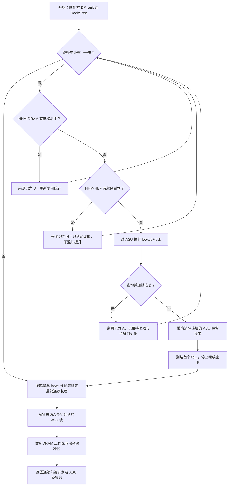
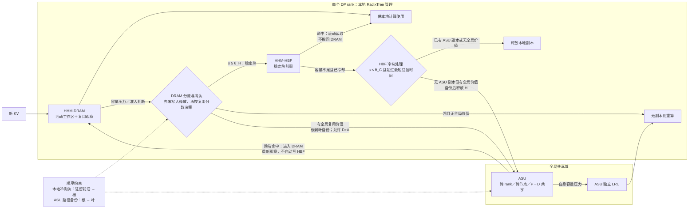

```
我们发现该系统与现有系统有几个不一样的点：
1. 互联域不同：HHM是每卡独有，ASU是全局共享。这一点和hicache的HBM+DRAM+SSD最像，唯一的差别是DRAM这一层是机内共享的，而HHM-HBF则是卡内独享的。不过hicache的DRAM这一层本身也不会跨卡复用，所以软件上可能刚好一样了。
2. 互联方式不同：仅仅允许 HHM-DRAM <-> HHM-HBF, HHM-DRAM <-> ASU, HHM-HBF <-> ASU 这三种南北向数据通路，数据不允许走P2P东西向通路（但是控制信号还是可以走的）。
3. ASU这一层其实是一种类似nvidia ICMS的高带宽、高IOPS、全局池化的KV语义存储层，可以抽象为具有5种基本操作：
     - lookup: 查询一个Key是否存在
     - lock/unlock: 要使用一个key之前，先锁住，避免它在使用时ASU内部的自动淘汰算法把它淘汰了。unlock则是解锁。
     - read: 指定key，读取value(也即kvcache block数据)，会直通到NPU HHM上
     - write: 指定key，写value，同样会直通。注意这里读写的单位都是整个KV block ，不允许部分写
     - delete: 指定key，主动删除它，腾出空间（另外ASU内根据自身剩余容量，也会主动淘汰掉一些block，淘汰算法是LRU）
     - 以上操作也可能组合出一些合并的原子操作，比如 lookup+lock 原子操作
   需要注意区分 "KV语义" 和 "KVcache" ，KV语义是指由指定的Key，可以lookup/lock/unlock/read/write/delete特定的Value，只不过这个Value存的实际上是kvcache block。而kv语义的key可以是kvcache的token hash+position


此外，我们针对KVC管理系统还给出这几个原则：
1. 算传同步：为了设计简单，所有的前缀缓存在数据面的传输（包括promote和demote）都必须和model.forward一起走，也即同步执行（可跨层掩盖），但是不能异步执行。
2. 命中率原则：
     - HHM命中率越高越好。在HHM内部，命中HBF和命中DRAM是一样的（因为HBF命中可以通过滚动加载消除其影响，对性能没有任何影响）
     - ASU命中率越高越好。如果一个块没有命中 HHM ，就看 ASU有没有命中。ASU命中相比HHM命中有特定的性能损失，但总比完全没命中要好
3. 降写原则：HHM-HBF和ASU都有特定的写寿命，应该尽量少写。其中HHM-HBF的寿命问题更严重一些。
```


# HHM＋ASU 原生 KVC 管理系统：方案抽象与算法设计

> 设计对象：面向 HHM＋ASU 硬件的前缀 KV cache 管理系统。  
> 设计蓝本：继承 HiCache 的“每 DP rank 本地 RadixTree”思路，但重新设计共享域、数据通路、命中流程、写入准入和三级淘汰。  
> 基本部署假设：一个 DP rank 对应一张 NPU；若启用 TP，则由同一 TP 组协调前缀长度，每个 TP rank 管理自己的 KV 分片。EP 域不构成额外的 KV cache 共享边界。

## 一、设计目标与硬件约束

### 1.1 硬件能力

每张 NPU 的本地存储与全局存储抽象如下：

| 层级 | 本文符号 | 容量与带宽 | 软件共享域 | 主要角色 |
|---|---|---|---|---|
| HHM-DRAM | $C_D$ | 36 GB 物理容量，24 GB 可用，3.2 TB/s | 每卡私有 | 活动工作集、新 KV 落点、HBF／ASU 的层内滚动缓冲 |
| HHM-HBF | $C_H$ | 320 GB，800 GB/s | 每卡私有 | 稳定、长寿命前缀的本地容量层 |
| ASU | $C_A$ | 全局池化；容量与有效带宽作为部署参数 | 全局共享 | 跨 DP rank、跨节点复用，以及全局 KV 语义存储 |

HHM-DRAM 与 HHM-HBF 合封在同一颗 NPU 的 HHM 内。本文把二者视为不同的物理驻留层，但在命中率指标上统一计为 **HHM 命中**。

### 1.2 数据通路约束

只允许以下三种南北向数据通路：

$$
C_D\leftrightarrow C_H,\qquad
C_D\leftrightarrow C_A,\qquad
C_H\leftrightarrow C_A .
$$

不允许 KV 数据走卡间或节点间 P2P 东西向通路；控制信号仍可跨卡、跨节点传输。因此：

- 跨 DP rank 复用必须经过 ASU，不能直接从另一张卡的 HHM-DRAM 或 HHM-HBF 拉取。
- ASU 命中可直通本卡 HHM；默认进入 HHM-DRAM 的滚动缓冲区，而不是一命中就写入 HHM-HBF。
- HHM-HBF 不应成为 ASU 的必经中转层，否则会增加 HBF 写入并加剧寿命压力。

### 1.3 ASU 的 KV 语义

ASU 不是另一棵全局 RadixTree，而是一个支持 KV 语义操作的全局对象层：

| 操作 | 语义 | 在本方案中的用途 |
|---|---|---|
| `lookup(key)` | 查询 key 是否存在 | 从首个本地未命中块开始，顺序探测 ASU 前缀 |
| `lock(key)`／`unlock(key)` | 防止使用中的对象被 ASU 自动淘汰 | 锁住本次准备读取的连续前缀，读完后释放 |
| `read(key)` | 原子读取整个 KV block | 在 `model.forward` 内读取到本卡 HHM |
| `write(key, value)` | 原子写入整个 KV block | 在 `model.forward` 内备份完整、不可变块 |
| `delete(key)` | 主动使对象失效 | 用于显式失效或管理操作，不作为普通本地淘汰的固定动作 |

建议补充两种复合原子操作：

- `lookup+lock`：消除“lookup 成功、lock 前已被 LRU 淘汰”的竞态。
- `write_if_absent`：多个 DP rank 同时备份相同前缀时避免重复写入；若没有该操作，应由 ASU 内部按 key 去重。

这里的 **KV 语义** 指 key→value 的查找、保护、读写和删除接口；value 恰好是不可变的 KV cache block，并不意味着 ASU 需要理解 RadixTree。

### 1.4 设计原则

1. **算传同步。**所有 promote、demote、备份和淘汰引起的数据面传输，都必须伴随一次 `model.forward` 同步发起并完成，可跨层流水掩盖，但不能由后台线程异步搬迁。
2. **先 HHM、后 ASU。**HHM-DRAM 与 HHM-HBF 命中都优先于 ASU；在给定“HBF 可滚动加载且命中不损失性能”的前提下，二者对命中目标等权。
3. **减少写入。**HHM-HBF 的写寿命约束强于 ASU，应优先减少 HBF 的重复写、短期写和往返搬运；ASU 也应避免无复用价值的写入。
4. **连续前缀。**无论从哪一层取数，请求可见的命中都必须从第一个 block 开始连续，不能跳过中间缺口使用后续块。
5. **本地提示而非全局强一致。**各 DP rank 的 RadixTree 只保存自身视角的驻留提示；ASU 的实际存在性以最近一次 `lookup` 或 `lookup+lock` 为准。

## 二、总体架构抽象

### 2.1 三级缓存的角色分工

```text
DP rank 0：本地 RadixTree                DP rank 1：本地 RadixTree
          │                                       │
   NPU 0：C_D ⇄ C_H                      NPU 1：C_D ⇄ C_H
             ⇅   ⇅                                  ⇅   ⇅
             └───┴──────────  ASU  ────────────────┴───┘
                    全局 KV 语义、独立目录、内部 LRU

禁止：NPU 0 的 C_D/C_H ⇄ NPU 1 的 C_D/C_H 直接传数据。
```

三级并非传统意义上简单的“越往下越冷”：

| 层级 | 应保存的对象 | 不应承担的角色 |
|---|---|---|
| $C_D$ | 寿命最短的活动 KV、新产生或尚未填满的块、滚动读缓冲，以及等待复用观察的完整块 | 长期保存所有稳定前缀；容量不足时无差别堆积 |
| $C_H$ | 经 DRAM 的时间窗 LRU 与复用统计证明会长期复用的稳定热前缀 | 每个 ASU 命中块的默认写入地；频繁换入换出的临时缓存 |
| $C_A$ | 有跨请求或跨 DP rank 复用价值的完整块、P→D 等明确跨端事务的数据 | 由某个 DP rank 强一致维护的全局 RadixTree；无差别保存所有瞬时块 |

因此，$C_D$ 同时是 $C_H$ 的**观察与准入层**：新块先在这里经历一段时间窗的 LRU 观察，频繁复用者迁移到 HBF，否则按全局复用价值写入 ASU 或直接丢弃。$C_D$ 到 $C_H$ 是**稳定化迁移**，$C_H$ 到 $C_A$ 则是以冷却和全局复用为目标的撤离。

### 2.2 副本状态：本地互斥、全局选择性重叠

为了减少本地双份占用和无效 HBF 写入，只需要关注以下稳态：

| 状态 | 含义 |
|---|---|
| $D$ | 新块、短寿命块和仍在接受复用观察的块只保存在 DRAM |
| $D+A$ | ASU 提供全局备份，DRAM 继续服务本地请求或接受 HBF 准入观察 |
| $H$ | 稳定热块驻留 HBF，不再长期占用 DRAM |
| $A$ | 本地副本已释放，只保留 ASU 全局副本 |
| $\varnothing$ | 没有缓存副本，后续需要时重算 |

核心原则是：**本地 DRAM／HBF 不长期重复保存同一块，D+A 则允许存在。**本地副本迁移或释放时，不重写也不主动删除已有 ASU 副本；ASU 仍由自身 LRU 独立管理。

### 2.3 命中指标

对一个请求需要的前缀 block 总数 $N$，按实际取数来源定义：

- $N_D$：HHM-DRAM 命中数；
- $N_H$：HHM-HBF 命中数；
- $N_A$：本地未命中、但 ASU 命中数；
- $N_M$：完全未命中、必须重算的 block 数。

则：

$$
N=N_D+N_H+N_A+N_M,
$$

$$
\eta_{\mathrm{HHM}}=\frac{N_D+N_H}{N},\qquad
\eta_{\mathrm{ASU}}=\frac{N_A}{N},\qquad
\eta_{\mathrm{total}}=\frac{N_D+N_H+N_A}{N}.
$$

优化顺序是：先提高 $\eta_{\mathrm{HHM}}$，再提高 $\eta_{\mathrm{ASU}}$，同时约束 HBF／ASU 写放大和 `forward` 内的传输时间。

## 三、对象、键与本地元数据

### 3.1 不可变 KV block

为同时满足“整块读写”和“降低写次数”，建议采用以下规则：

1. block 按固定 token 数切分；只有填满并封口的完整块才能写入 $C_H$ 或 $C_A$。
2. 尚未填满的 decode 尾部块只留在 $C_D$，继续追加，不对下级层反复覆盖写。
3. 完整块一旦封口即不可变；不同内容必须对应不同 key，禁止原地更新。
4. 为支持跨层流水，物理 value 宜按“token block × layer group”组织。若一个 value 包含所有层，则只能在首层计算前整块读取，无法细粒度地跨层掩盖。

### 3.2 前序 hash-chain 与 ASU key

仅使用“token hash＋position”不足以避免不同上下文的冲突。建议采用前序链：

$$
\begin{aligned}
p_0 &= H(\mathrm{model\_rev},\mathrm{kv\_layout},\mathrm{cache\_salt}),\\
p_i &= H(p_{i-1},\mathrm{token\_block}_i),\qquad i=1,\ldots,n,\\
k_{i,g} &= H(p_i,i,g,\mathrm{shard\_layout}).
\end{aligned}
$$

其中：

- $i$ 是 token block 的位置，$g$ 是 layer group；
- `model_rev`、`kv_layout` 和 `cache_salt` 防止不兼容缓存误复用；
- `shard_layout` 描述 TP 等物理分片方式，可以包含分片位置，但**不能包含 DP rank 标识**，否则相同前缀无法跨 DP rank 去重；
- 不同 DP rank 只要模型、布局和前缀内容相同，就能独立推导出相同 key。

### 3.3 每 DP rank 的 RadixTree

每个 DP rank 维护自己的 RadixTree，不维护全局树。节点除 token 路径外，建议保存：

| 字段 | 含义 |
|---|---|
| `prefix_key / block_pos / layer_group` | 推导 ASU key 所需的信息 |
| `residency` | 每个物理块在 $D/H/A$ 的驻留位图 |
| `ptr_D / ptr_H` | 本地 DRAM／HBF 地址或块句柄 |
| `asu_state` | `UNKNOWN／PRESENT／ABSENT／LOCKED`；只是提示，不是全局权威状态 |
| `lock_ref` | 当前请求或正在进行的同步传输是否保护该节点 |
| `last_access / reuse_count / distinct_requests` | 本地冷热与稳定复用统计 |
| `stable_score` | 是否适合长期驻留 HBF 的综合评分 |
| `write_count_H / write_count_A` | 识别反复写入与缓存抖动 |
| `children / parent` | 本地前缀结构、叶优先释放与元数据修剪 |

RadixTree 节点可以只保留元数据而没有 HHM 数据，例如该块仅存于 ASU。这样，本地树仍然是该 DP rank 的私有前缀目录，但不要求每个树节点都对应本地物理副本。

### 3.4 ASU 删除后的懒惰更新

ASU 自己执行 LRU，其他推理实例也可能显式 `delete`，所以本地 `PRESENT` 提示可能过期。处理规则为：

1. 需要使用该块时执行 `lookup+lock`。
2. 若返回 miss，清除该节点的 ASU 驻留位，并将其标为 `ABSENT`；不要继续假设后续块形成可用 ASU 前缀。
3. 若节点仍有 $D/H$ 副本，**只清除 ASU 提示，不删除整个 RadixTree 节点**。
4. 只有当节点没有任何 $D/H/A$ 副本、没有锁且是叶节点时，才删除该元数据节点，并递归修剪失去孩子的空父节点。
5. `ABSENT` 不能永久缓存，因为其他 DP rank 之后可能重新写入；可在后续请求重新探测，或使用很短的负缓存 TTL。

## 四、命中查询与算传同步

### 4.1 统一查询流程

命中不能先分别计算“HHM 前缀”和“ASU 前缀”再简单相加，因为实际前缀可能混合来源，例如根块在 ASU、后续块在 HBF。应逐块构造连续计划：



流程要点：

1. **本地优先。**每块先查 DRAM，再查 HBF；二者都命中 HHM，但 HBF 命中不做整块 DRAM 晋升。
2. **按需查询 ASU。**只有本地未命中才执行 `lookup+lock`，成功后才把该块纳入计划。
3. **缺口即停止。**任何一块在 D、H、A 都不可用，就停止查询，后续块不能计入连续前缀。
4. **统一收口。**最后根据容量和 `forward` 传输预算确定可用长度，解锁多余对象，并预留滚动缓冲区。

如果只能分别调用 `lookup` 和 `lock`，则 lock 失败时必须重查或停止，不能把此前的 lookup 结果当作仍可读取的保证。

### 4.2 `model.forward` 内的数据面执行

设当前计算第 $g-1$ 个 layer group，则可为第 $g$ 组准备数据：

| 来源 | 数据面动作 | 驻留状态是否改变 |
|---|---|---|
| $C_D$ | 直接引用已就绪 KV | 不变 |
| $C_H$ | 滚动执行 $C_H\rightarrow C_D$ 的层组缓冲读取 | 默认不变，不产生整块 DRAM 晋升 |
| $C_A$ | 滚动执行 $C_A\rightarrow C_D$，读取已 lock 的对象 | 默认只保留临时 DRAM 缓冲，不写 HBF |
| 未命中 | 正常计算新 KV，并先写入 $C_D$ | 新完整块初始为 $D$，未满块不共享 |

`forward` 返回前必须完成本次计划内的数据传输，并释放不再需要的 ASU lock；异常路径也必须通过 `finally` 语义解锁。不能在请求结束后遗留后台 promote／demote。

### 4.3 同步流水预算

若希望缓存读取不显著拉长 step time，应满足近似条件：

$$
T_{\mathrm{data}}(\mathrm{plan})\leq T_{\mathrm{compute}}(\mathrm{plan}),
$$

其中 $T_{\mathrm{data}}$ 必须包含 HBF 读取、ASU 读取、DRAM 缓冲写入和共享接口争用。该条件需要通过实测分层标定，不能仅根据峰值带宽相除得出结论。

当计划超出容量或传输预算时，应缩短 ASU 命中范围并重算余下部分，而不是把传输转成后台任务。每个 `forward` 可设置最大 HBF／ASU 读写字节数，避免一次大批量淘汰阻塞整步计算。

## 五、写入与准入策略

本章只保留一条主线：**新块先在 DRAM 中观察，稳定热块迁移到 HBF，有全局复用价值的块备份到 ASU，其余冷块直接丢弃。**目标不是保存所有 KV，而是用尽量少的 HBF／ASU 写入保留最值得复用的前缀。

**第 5–6 章设计总图：**



### 5.1 新块在 DRAM 中观察，然后三路分流

| 块的状态 | 默认处理 | 目的 |
|---|---|---|
| 经过观察仍稳定热 | **稳定热块准入**：迁移到 HBF，确认写入后释放 DRAM | 让 HBF 保存低 churn、长期复用的热前缀 |
| 有跨请求、跨 rank、跨节点或 P→D 复用价值 | 按前缀路径备份到 ASU | 支持全局共享，但不强求长期保留 |
| 已冷却且无全局复用价值 | 直接丢弃，未来重算 | 不为低价值块消耗写带宽和容量 |

因此，**DRAM 是观察与准入层**，同时也是活动工作区；HBF 不是 DRAM 的无条件溢出区，ASU 也不是所有本地冷块的默认收容所。

### 5.2 降低写入的三条规则

1. **D／H 稳态互斥。**DRAM 到 HBF 采用迁移语义，HBF 确认后立即释放 DRAM，避免长期双写。
2. **命中不制造额外副本。**HBF 命中通过滚动缓冲读取，不整块晋升 DRAM；ASU 命中也不自动写 HBF，须重新经过复用观察。
3. **写下级前查重。**ASU 优先使用 `write_if_absent`；HBF 根据本地驻留状态避免重复写。

### 5.3 副本关系只保留一个重点

**本地 DRAM／HBF 不长期重复保存同一块，D+A 则允许存在。**D+A 中，A 服务全局复用，D 继续服务本地请求并接受 HBF 准入观察。

本地副本迁移或释放时，不重写也不主动删除已有 ASU 副本；ASU 的全局副本由自身 LRU 独立管理。完整的准入判定和写入顺序见附录 A.2–A.4。

## 六、三级淘汰算法

三级缓存不采用同一种淘汰逻辑：**DRAM 负责观察和分流，HBF 只保留稳定热块，ASU 独立进行全局 LRU。**本地 DRAM／HBF 的迁移、备份与释放都纳入当前 `model.forward` 的同步预算，不依赖请求结束后的后台卸载。

### 6.1 三层各自负责什么

| 层级 | 空间不足时优先处理 | 核心目标 |
|---|---|---|
| DRAM | 重复副本 → 稳定热块迁移 HBF → 冷块备份 ASU 或丢弃 | 先减少写入，再保住稳定热前缀 |
| HBF | 只处理已冷却且满足最短驻留时间的块 | 避免热块抖动和 DRAM↔HBF 往返 |
| ASU | 由 ASU 自身按全局 LRU 淘汰 | 与本地树解耦，提供尽力而为的共享缓存 |

每个 DP rank 用本地 RadixTree 记录前缀关系、D／H／A 驻留状态和复用分数；ASU 不参与本地树维护，本地只在后续查询时修正 ASU 驻留状态。

### 6.2 冷热只用一个分数和三个阈值

每个请求对同一节点最多记一次命中。分数同时考虑复用频率和时间新近性：

$$
s(v,t)=\sum_{q\in Q_v}e^{-(t-q)/\tau},
$$

其中 $Q_v$ 是历史命中时刻集合，$\tau$ 是观察时间常数。命中越频繁、越近，分数越高；长期未复用，分数自然衰减。

| 参数 | 含义 | 直观理解 |
|---|---|---|
| $\theta_H$ | HBF 热准入阈值 | 足够热才值得写 HBF |
| $\theta_C$ | HBF 冷淘汰阈值 | 明显冷却后才可以撤离 HBF |
| $\theta_A$ | 普通 ASU 备份阈值 | 有基本复用价值才值得全局备份 |

阈值满足 $\theta_A\leq\theta_C<\theta_H$。热准入与冷淘汰之间保留间隔，再配合 HBF 最短驻留时间 $T_H$，避免同一块在刚写入后又被淘汰。明确的跨端或 P→D 消费者可以绕过普通 ASU 分数门槛。

### 6.3 DRAM：先省写，再保热，最后处理冷块

在 RadixTree 上，**稳定热迁移与冷块淘汰的选点范围不同**。稳定热迁移可以看整棵树中的 DRAM 节点，包括内部节点；冷块备份或丢弃则从 **DRAM 驻留前沿**开始。这里的前沿是每条前缀分支上最深、仍持有 DRAM 副本且没有 DRAM 孩子的未锁节点，相当于 DRAM 驻留子树的外边界，**不要求是整棵 RadixTree 的叶子**。前沿节点释放后，其父节点才可能成为新的候选，使 DRAM 驻留范围逐层向根收缩。

DRAM 空间不足时按以下顺序执行：

1. **零写入释放。**优先释放无需写下级即可安全删除的本地副本，例如已有 ASU 副本且不需要继续本地驻留的 DRAM 块。
2. **稳定热块迁移 HBF。**将满足热准入的完整块写入 HBF，确认后释放 DRAM。内部节点也可以迁移，不因仍有孩子副本而被排除，避免最热的共享根长期占住 DRAM。
3. **冷块备份或丢弃。**仍有全局价值的块按前缀路径备份 ASU；已有 ASU 副本的直接释放；无价值或备份失败的直接丢弃。

一句话概括：**能不写就不写，值得长期复用才写 HBF，值得全局共享才写 ASU。**

### 6.4 HBF：只淘汰冷块，不做热块抖动

HBF 也从自己的 **HBF 驻留前沿**选择淘汰候选，而不是沿用 DRAM 前沿或从整棵树的叶子开始。一个节点即使还有孩子，只要孩子没有 HBF 副本，它仍可位于 HBF 前沿；孩子释放 HBF 副本后，父节点才可能进入候选。因此，DRAM 和 HBF 可以沿同一棵 RadixTree 的不同驻留边界分别收缩。

HBF 空间不足时，只在已经冷却、未被锁定且超过最短驻留时间的块中选择：

- 已有 ASU 副本的，直接释放 HBF，不产生新写入；
- 没有 ASU 副本但仍有全局价值的，备份 ASU 后释放；
- 其余块直接丢弃，未来重算。

HBF 块不因 DRAM 空间紧张而搬回 DRAM；即使后续重新变热，也继续从 HBF 滚动读取并累积复用分数。

### 6.5 两条顺序不能混淆

- **本地冷淘汰：从驻留前沿向根收缩。**先处理没有同层孩子副本的未锁节点，孩子释放后，父节点才可能成为新的候选，避免先删父块而使后续块无法连续命中。
- **ASU 路径备份：从根到叶。**只有前缀祖先已存在或写入成功后，才继续备份后续块，保证写入时形成可连续复用的路径。

这两条顺序分别服务于“安全收缩本地副本”和“建立连续全局前缀”，方向相反，不能互换。RadixTree 字段、驻留前沿的严格定义、完整伪代码与复杂度见附录 A。

## 七、请求生命周期与跨端复用

### 7.1 Prefill

1. 调度前或 `forward` 控制准备阶段完成本地树匹配和 ASU `lookup+lock`。
2. `forward` 内按 layer group 滚动读取 HBF／ASU 前缀，未命中部分正常计算。
3. 新 KV 先落 DRAM；未满尾部块不写 HBF／ASU。
4. 若容量压力触发降级，所有数据移动都并入本次或后续 `forward` 的同步预算。

### 7.2 Decode

1. 热工作集优先保留在 HHM；HBF 命中不需要整块提升回 DRAM。
2. 新 token 只更新 DRAM 中的当前尾部块，不做每 token 的 HBF／ASU 写。
3. 尾部块填满封口后，才成为稳定化和全局备份候选。
4. 请求结束时不能依赖后台卸载；若需要保存完整块，必须在最后一个相关 `forward` 内完成，否则允许仅保留本地副本或丢弃。

### 7.3 跨 DP rank 与 P→D

跨 DP rank 复用只走：

$$
D/H\rightarrow C_A\rightarrow D_{\mathrm{target}}.
$$

控制面可以交换调度和提示信息，但不能交换 KV 数据。若 ASU 同时承担 P→D 事务，应为该事务设置独立 lock／unlock 和完成确认；事务完成后的缓存去留仍由普通准入与淘汰策略决定，不能把一次 P→D 临时传输自动等同于永久共享缓存。

## 八、与 HiCache 蓝本的关系

| 维度 | 可继承的抽象 | HHM＋ASU 原生设计的差异 |
|---|---|---|
| 本地目录 | 每 DP rank 私有 RadixTree，按 token 做最长前缀匹配 | 节点同时记录 $D/H/A$ 驻留提示；无本地副本的节点也可作为 ASU 元数据 |
| 全局目录 | 外部层按需查询，不同步完整全局树 | ASU 直接提供 KV 语义、lock 和独立 LRU，本地树懒惰修正 |
| 本地容量层 | 树结构表达共享前缀 | DRAM 是短寿命观察与准入层，HBF 是稳定热容量层，不以普通冷 LRU 下沉 |
| 副本重叠 | 各层可因写入和淘汰策略形成包含或重叠 | 本地 DRAM／HBF 不长期重复保存同一块；允许 $D+A$，ASU 独立管理全局副本 |
| 跨卡数据面 | 没有依赖卡间 P2P 的必需路径 | 明确禁止 KV 东西向 P2P，所有跨端数据必须经过 ASU |
| 数据传输 | 外部命中经缓冲后供计算使用 | 所有读写、promote、demote 都限定在 `model.forward` 内同步完成 |
| HBF 命中 | 上级容量层通常需要加载到更快层 | 按给定硬件前提，以层组滚动读取消除整块晋升，命中后不改变驻留 |
| ASU 备份 | 外部 backup 可异步并独立淘汰 | 选择性写入，按根到叶补齐；本地仍优先释放冷叶 |
| 写寿命 | 通常关注容量、命中和传输开销 | HBF 写入是强约束，需要稳定准入、最短驻留、查重和防抖动 |

## 九、需要标定的参数与观测指标

### 9.1 策略参数

| 参数 | 作用 | 标定方向 |
|---|---|---|
| `DRAM_HIGH / DRAM_LOW` | DRAM 同步淘汰水位 | 避免频繁小淘汰，也给滚动缓冲留空间 |
| `HBF_HIGH / HBF_LOW` | HBF 淘汰水位 | 配合最短驻留时间降低 churn |
| `SCORE_TAU`（$\tau$） | 复用分数的指数衰减时间常数 | 决定观察窗口；过短偏向瞬时热点，过长保留历史旧热点 |
| `HBF_HOT_THRESHOLD`（$\theta_H$） | 稳定热与 HBF 准入分数阈值 | 过低增加 HBF 写入，过高降低 HHM 容量利用率 |
| `HBF_COLD_THRESHOLD`（$\theta_C$） | HBF 冷淘汰分数阈值，需小于 $\theta_H$ | 与热阈值形成滞回，避免同一节点频繁迁入迁出 |
| `ASU_REUSE_THRESHOLD`（$\theta_A$） | 普通 ASU 备份的最低分数，需不大于 $\theta_C$ | 在跨端命中率与 ASU 写放大之间折中 |
| `HBF_MIN_RESIDENCY`（$T_H$） | HBF 最短驻留及防重复写入时间 | 防止刚写入又立刻淘汰 |
| `FORWARD_READ_BUDGET` | 每次 forward 最大 ASU／HBF 读取量 | 依据分层计算时间和实测带宽确定 |
| `FORWARD_WRITE_BUDGET` | 每次 forward 最大同步降级写入量 | 防止维护流量阻塞计算 |
| `NEGATIVE_HINT_TTL` | ASU miss 提示的短暂有效时间 | 减少无效 lookup，同时允许其他 rank 后续写入 |

### 9.2 必须记录的指标

- 按 token block 统计的 $N_D/N_H/N_A/N_M$ 与连续前缀长度；
- DRAM、HBF、ASU 的驻留块数与字节数，以及本地重复副本占用的容量；
- HBF／ASU 每层写入字节数、唯一块写入次数、重复写入次数；
- HBF 平均驻留时间、写入后短期淘汰比例、DRAM↔HBF 往返次数；
- ASU lookup miss、提示过期、lock 失败、lock 持有时长与显式 delete 次数；
- 每次 `forward` 的读取／写入字节、传输耗时、计算耗时和未被掩盖的增量时延；
- 因容量或传输预算截断的 ASU 前缀长度，以及无备份丢弃后的重算量。

### 9.3 方案成立的验证重点

1. **HBF 命中等效假设：**在真实层组流水与并发负载下，800 GB/s 是否足以被计算掩盖。
2. **稳定热准入是否有效：**HBF 写放大是否显著低于朴素冷 LRU，同时 $\eta_{\mathrm{HHM}}$ 不下降。
3. **副本管理是否有效：**本地 DRAM／HBF 是否避免长期重复保存，D+A 是否能在本地副本失去价值后及时释放。
4. **根到叶备份的收益：**跨 DP rank 的可用连续前缀是否增加，而不是只增加 ASU 中不可达的尾部对象。
5. **同步维护是否可承受：**淘汰和备份造成的 `forward` 增量时延是否低于命中节省的重算时间。
6. **懒惰一致性开销：**ASU 独立 LRU 导致的 stale 提示比例、额外 lookup 和错误计划是否可控。

## 十、方案结论

这套系统的关键不是把 HiCache 的三级缓存机械映射到三种介质，而是形成以下组合：

> **每 DP rank 私有 RadixTree＋HHM-DRAM 短寿命观察与准入＋HHM-HBF 稳定热容量层＋ASU 全局 KV 语义层＋本地 D／H 稳态互斥与选择性 D+A＋forward 内同步数据面＋根到叶 ASU 备份与本地冷叶释放。**

其中最重要的三条差异化策略是：

1. **DRAM 先观察、再分流：稳定热块迁移 HBF，其余块按全局价值写入 ASU 或丢弃。**
2. **HBF 以稳定准入、长期驻留和本地 D／H 互斥降低写入与双份占用，而不是作为普通冷数据的临时堆场。**
3. **ASU 以原子 lookup+lock 保证读取时可用，以根到叶写入支持跨端连续前缀；本地树只维护提示，并通过 miss 懒惰修正。**

这三条策略分别对应 HHM＋ASU 硬件最关键的短寿命观察、写寿命与全局共享特征，也构成后续仿真、性能建模和原型实现应优先验证的对象。

---

## 附录 A：淘汰算法实现细则

本附录保留实现所需的完整定义。正文第 5、6 章用于理解设计主线；进行仿真或编码时，再以本附录为准。

### A.1 RadixTree、驻留位与淘汰前沿

每个 DP rank $r$ 维护一棵本地树 $T_r$。根是空前缀；树在 KV block 边界分裂，因此每个非根节点唯一对应一个固定 token block。节点可以保存多个 layer group 的物理块，以下省略 layer group 下标，算法对每个 layer group 独立执行，节点复用分数则由各 layer group 共用。

从根到节点 $v$ 的完整路径记为：

$$
P(v)=(v_1,v_2,\ldots,v_k),\qquad v_k=v .
$$

每个节点至少保存以下字段：

| 字段 | 精确定义 |
|---|---|
| `children(v)`／`parent(v)` | 本地前缀树的拓扑关系 |
| `key(v)` | 当前 layer group 对应的 ASU key |
| $D(v),H(v),A(v)$ | 当前物理块是否存在于 DRAM、HBF、ASU，取值为 0 或 1 |
| `ptr_D(v)`／`ptr_H(v)` | 本地物理副本句柄；副本释放后清空 |
| $size(v)$ | 当前 layer group 中该物理块的字节数，用于累计释放量和空间预留 |
| `sealed(v)` | 是否为已填满、不可再追加的完整块 |
| $\ell(v)$ | 本地读、写和迁移的引用锁计数；$\ell(v)>0$ 时禁止淘汰 |
| $s(v)$ | 时间衰减复用分数，按 A.2 节更新 |
| $t_v$ | 分数最近一次惰性更新的时间 |
| $a_v$ | 最近一次请求命中时间，用于同分时的 LRU 排序 |
| $h_v$ | 最近一次写 HBF 的时间；从未写入时取 $-\infty$ |
| $g(v)$ | 调度器设置的强制 ASU 备份标记，用于明确的跨端或 P→D 消费者 |

冷块的 ASU 备份、直接丢弃和 HBF 冷却淘汰分别在以下两个**驻留前沿**上选择节点：

$$
F_D=\left\{v\mid D(v)=1,\ \ell(v)=0,\ \forall u\in children(v):D(u)=0\right\},
$$

$$
F_H=\left\{v\mid H(v)=1,\ \ell(v)=0,\ \forall u\in children(v):H(u)=0\right\}.
$$

也就是说，冷块只有没有同层孩子副本时才可被淘汰。释放 D／H 后，节点仍可作为元数据或其他层副本存在；其父节点若没有其他同层孩子，就进入相应前沿。这保证冷块淘汰沿各驻留分支向根收缩，同时允许“父节点在 ASU、孩子在 HBF”等混合驻留状态。

**稳定热迁移不受 $F_D$ 限制。**任何满足 $\operatorname{AdmitH}$ 的 D 节点都可写 HBF 并释放 D，包括仍有 D 孩子的共享根；否则最热的内部节点会永远占住 DRAM。为保留防重复写统计，无 D／H／A 副本、无孩子且无锁的节点，只有在最后一次副本释放满 $T_H$ 后才从树中删除；冷却期内保留为无物理副本的元数据节点。

下文的“释放 D／H”只清除对应物理副本和驻留位；所有迁移、备份及释放都在当前 `model.forward` 内同步完成。

### A.2 复用打分、稳定热与准入条件

#### 时间衰减复用分数

对每个节点，每个请求最多记一次命中，不因 layer group 数或同一请求内多次访问重复加分。设历史命中时刻集合为 $Q_v$，定义：

$$
s(v,t)=\sum_{q\in Q_v}e^{-(t-q)/\tau},
$$

其中 $\tau>0$ 是复用观察时间常数。实现时无需保存 $Q_v$，只做惰性更新：

- 任意时刻读取分数：$s(v)\leftarrow s(v)e^{-(t-t_v)/\tau}$，随后令 $t_v\leftarrow t$。
- 请求命中该节点：先执行上述衰减，再令 $s(v)\leftarrow s(v)+1$，并令 $a_v\leftarrow t$。
- 新产生但尚未被后续请求复用的节点：$s(v)=0$。

因此，$s(v,t)$ 同时表达频率和时间新近性；原始 LRU 时间 $a_v$ 只在分数相同时用于排序。

#### 三组阈值

配置参数满足：

$$
0<\theta_A\leq\theta_C<\theta_H,\qquad T_H>0 .
$$

- $\theta_H$：HBF 热准入阈值。
- $\theta_C$：HBF 冷淘汰阈值。
- $\theta_A$：普通 ASU 备份的最低复用分数。
- $T_H$：HBF 最短驻留及防重复写入时间。

**稳定热：**

$$
\operatorname{Hot}(v,t)\iff s(v,t)\geq\theta_H .
$$

**HBF 准入：**

$$
\begin{aligned}
\operatorname{AdmitH}(v,t)\iff{}&D(v)=1,\ H(v)=0,\ sealed(v)=1,\\
&\ell(v)=0,\ \operatorname{Hot}(v,t),\ t-h_v\geq T_H .
\end{aligned}
$$

**ASU 准入：**

$$
\operatorname{AdmitA}(v,t)\iff sealed(v)=1,\ A(v)=0,\ \bigl(g(v)=1\ \text{或}\ s(v,t)\geq\theta_A\bigr).
$$

其中 $\operatorname{AdmitH}$ 只决定是否值得写 HBF；实际写入前必须预留足够空间，只有空闲空间不足时才调用 A.5 节算法回收差额。若预留失败，则本轮不晋升，继续走 ASU 备份或丢弃路径。

HBF 可淘汰冷块定义为：

$$
\operatorname{ColdH}(v,t)\iff H(v)=1,\ \ell(v)=0,\ s(v,t)\leq\theta_C,\ t-h_v\geq T_H .
$$

### A.3 公共操作：根到叶的 ASU 路径备份

**算法 1：备份路径 $P(v)$**

输入为本地树 $T_r$、目标节点 $v$ 和当前 `forward`。按 $v_1,v_2,\ldots,v_k$ 的顺序执行：

1. 对当前节点 $v_i$ 调用 ASU `lookup`。若存在，置 $A(v_i)=1$，继续处理下一节点。
2. 若 ASU 不存在且本地也无 D／H 源副本，则备份失败并结束；不得跳过该节点继续写后续块。
3. 若本地存在 D／H 源副本，则锁定源副本，在本次 `forward` 内同步写入完整块到 ASU。
4. 只有收到 ASU ACK 后，才置 $A(v_i)=1$ 并解锁源副本，随后处理下一节点；写入失败同样结束整个备份。
5. 路径中所有节点均确认存在后才返回成功。为了让目标节点可被连续复用，路径上的祖先可以随目标一起备份，不再单独判断祖先自身的 $\operatorname{AdmitA}$。

ASU 之后仍可能按自身 LRU 删除路径中的任意节点，所以该算法只保证**写入顺序根到叶**，不保证永久包含。读取端仍以逐块 `lookup+lock` 和首个缺口停止保证正确性。

### A.4 DRAM 淘汰算法

**算法 2：DRAM 上的观察、迁移与淘汰**

输入：当前树 $T_r$、需要释放的字节数 $B$、当前时间 $t$。输出为实际释放字节数。每个阶段中，每释放一个节点都立即更新 $F_D$；累计释放达到 $B$ 就结束。同分节点一律按 $a_v$ 从小到大排序，即更久未命中者先处理。

**阶段一：零写入清理本地重复副本。**

1. 在整棵树的 D 节点中选择 $H(v)=1$ 的节点，按 $s(v,t)$ 从小到大直接释放 D，清理异常残留的 $D+H$。
2. 若空间仍不足，在 $F_D$ 中选择 $A(v)=1$ 且不满足 $\operatorname{AdmitH}$ 的节点，按分数从小到大直接释放 D，使 $D+A$ 收敛为 A。

**阶段二：稳定热块迁移 HBF。**

3. 在整棵树中取集合 $V_{hot}=\{v\mid D(v)=1,\ \operatorname{AdmitH}(v,t)\}$，按 $s(v,t)$ 从大到小处理。该集合包含内部节点，不要求节点属于 $F_D$。
4. 对每个节点先检查 HBF 空闲空间：若足够则直接预留；若不足，只针对不足差额执行算法 3。若最终仍无法预留 $size(v)$ 字节，则不再尝试本次 HBF 晋升；节点属于 $F_D$ 时留到阶段三，否则保留 D 并继续处理下一个热节点。
5. 空间预留成功后，在本次 `forward` 内执行 D→HBF 写入；收到 HBF ACK 后置 $H(v)=1$、$h_v=t$，再清除 D 位并释放 DRAM。若原来已有 ASU 副本，只保留该副本，不重写也不删除，因此结果为 H 或继承性的 $H+A$。

**阶段三：ASU 备份或无备份丢弃。**

6. 将当前 $F_D$ 中剩余节点按 $s(v,t)$ 从小到大处理：
   - 若 $A(v)=1$，直接释放 D；
   - 否则若满足 $\operatorname{AdmitA}$，执行算法 1，成功后释放 D；
   - 若不属于上述情况，或 ASU 路径备份失败，则直接丢弃这个无锁 D 副本，未来需要时重算。
7. 若 $F_D$ 为空而释放量仍不足 $B$，返回实际释放量；本轮请求必须缩减缓存计划或等待锁释放，不能淘汰被锁节点。

该算法的优先级是：**零写入释放 → 一次 HBF 写入保留稳定热块 → ASU 备份或丢弃**。它不会为了保留所有冷块而无条件写 HBF／ASU。

### A.5 HBF 淘汰算法

**算法 3：从 HBF 前沿释放指定字节数**

输入：当前树 $T_r$、需要释放的字节数 $B$、当前时间 $t$。输出为实际释放字节数。候选集合为：

$$
V_H(t)=\left\{v\in F_H\mid\operatorname{ColdH}(v,t)\right\}.
$$

每释放一个节点都更新 $F_H$ 和 $V_H$；累计释放达到 $B$ 就结束。

1. **先处理已有 ASU 副本的节点。**在 $V_H$ 中取 $A(v)=1$ 的节点，按 $s(v,t)$ 从小到大直接释放 H，使继承性的 $H+A$ 收敛为 A，不产生写入。
2. **再处理没有 ASU 副本的节点。**将剩余节点按 $s(v,t)$ 从小到大遍历：若满足 $\operatorname{AdmitA}$，执行算法 1，并在成功后释放 H；若不满足或备份失败，则直接丢弃 H 副本。
3. **更新前沿并结束。**释放 H 后更新父节点的 H 前沿状态；无其他副本和孩子的空节点按 A.1 节规则修剪。若 $V_H$ 为空而空间仍不足，返回实际释放量，使对应的 HBF 准入失败。

HBF 不设置“热块淘汰”：$s(v,t)>\theta_C$ 或 $t-h_v<T_H$ 的节点均不进入 $V_H$。算法 3 也不会把 HBF 块搬回 DRAM；重新变热的块继续通过 HBF 滚动读取，并正常累积复用分数。

### A.6 实现复杂度

分数采用惰性衰减，单次命中为 $O(1)$。一轮淘汰开始时，对当前候选集统一计算衰减分数，再分别以 $(s,a_v)$ 建立最小堆、以 $s$ 建立热准入最大堆；候选堆构建为 $O(|V|)$，节点插入和删除为 $O(\log |V|)$。每轮只遍历候选集而非整棵树，路径备份额外需要 $O(|P(v)|)$ 次 ASU 查询或写入。
