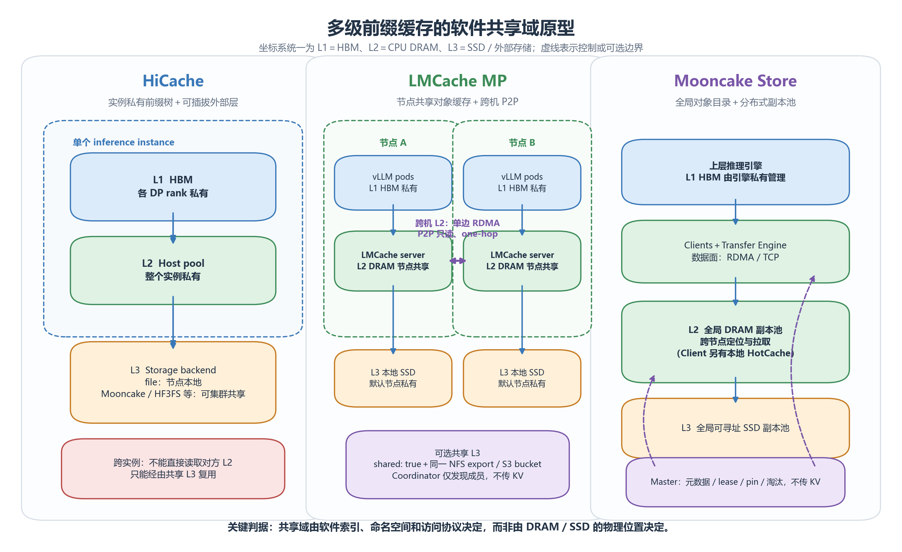
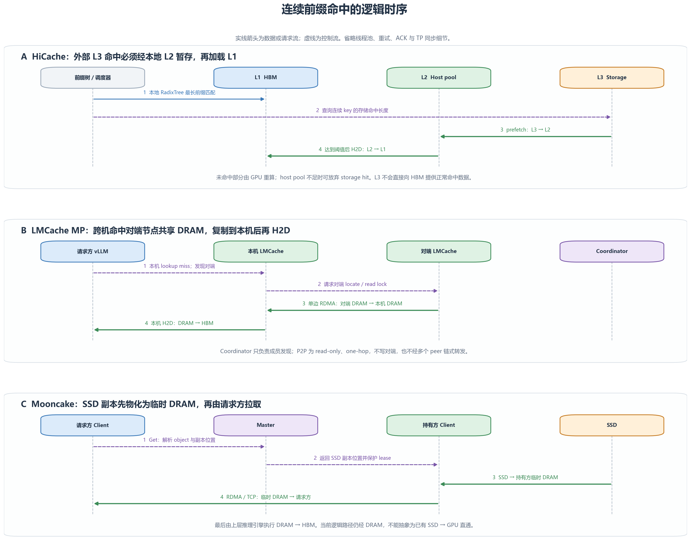
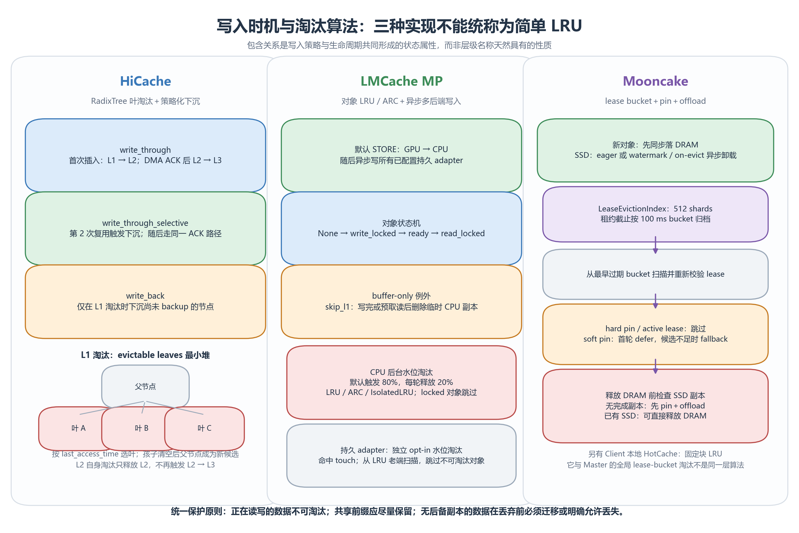

# 多级、多机前缀缓存管理：架构与算法抽象

> 调研对象：SGLang HiCache、LMCache MP、Mooncake Store。  
> 统一坐标：**L1＝加速器 HBM，L2＝CPU DRAM，L3＝SSD／外部持久存储**。  
> 调研口径：以当前生产文档和主线代码为准，不以早期论文代替现状；重点是共享域、数据通路、对象模型、命中、写入、淘汰和层级包含关系。

## 术语表：推理规模单位与层次关系

为避免把模型并行域、部署单元和缓存共享域混为一谈，本文采用以下操作性定义。不同框架的具体进程模型可能不同，判断缓存共享范围时仍以实际软件边界为准。

| 统一术语 | 定义 | 层次关系与使用约定 |
|---|---|---|
| **推理实例**（inference instance） | 一个独立部署、独立调度，具有自身模型执行与缓存管理上下文的推理引擎实例。 | 统一替代“inference instance”“引擎实例”和“vLLM 实例”；可位于单节点或跨节点，内部可包含多个 DP rank、TP 组与 EP 域。Kubernetes 语境中的一个 vLLM pod 按一个推理实例表述。 |
| **工作进程**（worker） | 实际执行模型计算的框架进程，通常绑定一个加速器。 | 是推理实例的执行单元，不等同于推理实例；具体进程与加速器的映射依框架实现而定。 |
| **DP rank** | 数据并行副本的编号；不同 DP rank 可处理不同请求。 | 属于推理实例内部。启用 TP 时，一个 DP rank 可对应一个 TP 组，因此不必然等于一个工作进程或一张卡。 |
| **TP 组／TP rank** | TP 组共同计算同一请求；TP rank 是组内成员编号。 | 属于推理实例内部；TP rank 不是独立推理实例，组内通常需要同步前缀命中边界。 |
| **EP 域／EP rank** | EP 域是共同承载一组切分专家的工作进程集合；EP rank 是域内成员编号。 | 是模型并行边界，可跨节点；不天然是 KV cache 共享域，也不等同于推理实例。 |
| **节点**（node／host） | 一台物理机或一个 Kubernetes 节点。 | 集群包含节点，节点可承载多个工作进程和推理实例；同节点不代表软件上共享缓存。 |
| **LMCache 缓存服务**（LMCache server） | 节点上独立部署的 CPU／持久缓存服务。 | 可服务同节点多个推理实例；不是推理实例、DP rank 或 EP 域。 |
| **Prefill／Decode 推理实例** | PD 分离部署中分别承担 Prefill 或 Decode 角色的推理实例。 | 是角色化推理实例；只有明确指硬件部署位置时，才使用“Prefill／Decode 节点”。 |

其层次关系应分两条轴线理解：

- **物理包含：**集群 → 节点 → 加速器；**逻辑组成：**推理实例 → 工作进程。
- **并行组织：**DP、TP、EP 是推理实例内部组织工作进程的不同维度，可能彼此交叠，不能画成固定的“推理实例 → EP 域 → DP rank → TP rank”树形层级。
- **缓存边界：**推理实例、DP rank、TP 组、EP 域和节点都不天然等于某级缓存的共享域；共享范围须由索引、命名空间和访问协议另行确定。

## 摘要

三套系统可以归纳为三种原型：

- **HiCache：推理实例私有前缀树＋可选共享外部层。** L1、L2 均属于单个推理实例；跨推理实例复用必须进入配置为共享的 L3。
- **LMCache MP：节点共享对象缓存＋跨机 P2P＋可插拔持久层。** 同一节点内多个相互独立的推理实例（Kubernetes 语境中通常是 vLLM pod，而非单个 DP rank）共享一个 LMCache 缓存服务的 CPU 缓存；跨机可直接从对端 CPU DRAM 读取，不必先落共享 SSD。
- **Mooncake Store：全局对象目录＋分布式副本池＋租约生命周期。** Master 管理元数据和副本位置，Client 之间传数据；DRAM 与 SSD 都是全局可寻址资源。

真正决定系统行为的不是“有几级内存”，而是五组机制：**软件共享域、元数据域、数据通路、写入时机、淘汰保护规则**。层级之间也不天然满足 $R_1(t)\subseteq R_2(t)\subseteq R_3(t)$：包含、互斥或临时驻留，都是具体策略和异步生命周期共同形成的状态属性。

本文检索时采用的主线快照为：SGLang `88151fa62c6129f56a80b2127a0f770be3de6f83`、LMCache `61faa902a81462177d40d74f8c64bb9df02163c4`、Mooncake `e13780da38b84f92ae30aa72a6fb43d57eb418ef`。[SGLang main snapshot](kimi-cite://web?url=https%3A%2F%2Fapi.github.com%2Frepos%2Fsgl-project%2Fsglang%2Fcommits%2Fmain&text=%22sha%22%3A%20%2288151fa62c6129f56a80b2127a0f770be3de6f83%22 "citation")，[LMCache dev snapshot](kimi-cite://web?url=https%3A%2F%2Fapi.github.com%2Frepos%2FLMCache%2FLMCache%2Fcommits%2Fdev&text=%22sha%22%3A%20%2261faa902a81462177d40d74f8c64bb9df02163c4%22 "citation")，[Mooncake main snapshot](kimi-cite://web?url=https%3A%2F%2Fapi.github.com%2Frepos%2Fkvcache-ai%2FMooncake%2Fcommits%2Fmain&text=%22sha%22%3A%20%22e13780da38b84f92ae30aa72a6fb43d57eb418ef%22 "citation")

> **存储层级映射提醒：**LMCache MP 自己把 CPU DRAM 称为 L1、持久后端称为 L2；本文始终映射回“HBM／DRAM／SSD”三级坐标。Mooncake 被 HiCache 当作外部 L3 时，其内部 DRAM、SSD 是该外部层的子层，不能重复计成两级。

---

# 一、架构抽象

## 1.1 统一模型：共享域、索引域与驻留集合

把请求切为页或 chunk，记其连续前缀对象为 $k_1,k_2,\ldots,k_n$。对第 $l$ 级缓存定义：

- $S_l$：**数据共享域**。哪些工作进程、推理实例或节点可通过软件接口读取该层副本。
- $I_l$：**索引／元数据域**。谁知道对象是否存在、在哪里、处于什么状态；它不一定等于 $S_l$。
- $R_l(t)$：时刻 $t$ 实际驻留于该层的对象集合，用于判断包含、互斥与临时副本。
- $P_{i,j}$：数据通路，例如本地 $L_2\rightarrow L_1$、远端 $L_2\rightarrow L_{2,\mathrm{local}\,}$、$L_3\rightarrow L_2$。
- $W_i$：写入策略与时机，例如首次写入、第二次复用、上层淘汰、后台水位。
- $E_i$：淘汰与保护规则，例如树尖收缩、对象 LRU、lease、pin、read/write lock。

由此得到一个重要判据：**物理上位于同一台机器，不等于软件上共享。**共享取决于命名空间、索引可见性、注册内存范围和访问协议，而不取决于 DRAM 的物理插槽位置。

## 1.2 三种共享域原型



*图 1：依据当前文档与代码归纳的软件共享域。图中 inference instance、vLLM pods 和 LMCache server 分别对应术语表中的“推理实例”“Kubernetes 语境下的推理实例”和“LMCache 缓存服务”；“全局”指同一逻辑命名空间和目录可寻址，不代表无条件跨集群开放。*

| 实现 | L1 HBM：$S_1$ | L2 DRAM：$S_2$ | L3 SSD／外部存储：$S_3$ | 跨机复用 L2？ |
|---|---|---|---|---|
| **HiCache** | 单个推理实例内，各 DP rank 管理自己的设备缓存 | **推理实例私有**；同机两个推理实例也不互读 | backend 与 namespace 决定；`file` 默认节点本地，分布式 backend 可集群共享 | **否**；须经共享 L3 |
| **LMCache MP** | 各推理实例自行管理 | **节点级共享**；一个 LMCache 缓存服务可服务同节点多个推理实例 | 默认推理实例／节点私有；adapter 可配置 `shared: true` | **是**；P2P 单边 RDMA 读入本机 DRAM |
| **Mooncake Store** | 上层推理实例私有管理 | **集群共享副本池**；Client 贡献内存段，Master 统一编目 | 全局可寻址副本；具体持久性、共享文件系统与 backend 配置相关 | **是**；Client 数据面直接拉取副本 |

HiCache 的官方文档明确把 L1、L2 限定为单个推理实例，并特别排除了同机推理实例间读取 L2；只有 L3 在 backend 支持并正确配置时才共享。[HiCache 设计：Tier Sharing Scope](kimi-cite://web?url=https%3A%2F%2Fdocs.sglang.ai%2Fadvanced_features%2Fhicache_design.html&text=L2%20is%20node-local%20and%20instance-private.%20It%20is%20host%20memory%20owned%20by%20one%20inference%20instance%E2%80%99s%20process%2C%20so%20two%20instances%20never%20read%20each%20other%E2%80%99s%20L2%2C%20not%20even%20two%20instances%20on%20the%20same%20node. "citation")

LMCache 缓存服务按节点部署，可向同节点多个推理实例（vLLM pod）提供共享缓存；因此在本文坐标系里，其 CPU DRAM 应抽象为**节点共享 L2**，而不是每 DP rank 私有 L2。[LMCache MP：架构](kimi-cite://web?url=https%3A%2F%2Fdocs.lmcache.ai%2Fmp%2Findex.html&text=One%20LMCache%20server%20per%20node%20can%20serve%20multiple%20vLLM%20pods%2C%20providing%20process%20isolation%2C%20shared%20caching%2C%20and%20independent%20resource%20scaling. "citation")

这里的 vLLM pod 按独立推理实例处理，而非单个 DP rank；官方 Kubernetes 部署通过 DaemonSet 在每个节点运行 LMCache 缓存服务，同节点多个 vLLM pod（即多个推理实例）自动连接它。一个推理实例内部可包含多个工作进程，并按 DP／TP／EP 组织，但 **EP 域不是 LMCache 的共享域边界**：这些推理实例可通过同一 LMCache 缓存服务共享 CPU 缓存，跨节点的 EP 域成员则必须通过 P2P 或共享持久层复用。具体 KV 能否复用仍受 model、KV layout、key／namespace 等兼容性约束。[LMCache MP：Kubernetes 部署](kimi-cite://web?url=https%3A%2F%2Fdocs.lmcache.ai%2Fmp%2Fdeployment.html&text=Multiple%20vLLM%20pods%20on%20the%20same%20node%20automatically%20connect%20to%20the%20same%20LMCache%20DaemonSet%20instance. "citation")

其持久 adapter 默认按推理实例私有处理；只有显式设置 `shared: true`，并让多个推理实例连接同一个 NFS export、S3 bucket 等存储域时，才把该 adapter 抽象为共享 L3。[LMCache MP：共享持久存储](kimi-cite://web?url=https%3A%2F%2Fdocs.lmcache.ai%2Fmp%2Fl2_storage%2Findex.html&text=Every%20adapter%20accepts%2C%20alongside%20its%20type-specific%20keys%2C%20the%20common%20%60%22shared%22%3A%20true%60%20option. "citation")

Mooncake 的 Client 既发起请求，也可把本地内存段贡献给集群；Master 统一组织逻辑资源池，但数据实际在 Client 之间传输。[Mooncake Store：Client](kimi-cite://web?url=https%3A%2F%2Fraw.githubusercontent.com%2Fkvcache-ai%2FMooncake%2Fmain%2Fdocs%2Fsource%2Fdesign%2Fstore%2Fmooncake-store.md&text=Data%20transfer%20is%20actually%20from%20one%20Client%20to%20another%2C%20bypassing%20the%20Master%20Service. "citation")

### 对“跨机命中 L2”的抽象回答

- **HiCache：不跨机复用 L2。**源推理实例先把对象写入共享 L3，目标推理实例再查询并加载。
- **LMCache MP：可以跨机复用 L2。**请求方让对端 lock/locate，再以单边 RDMA 把对端 CPU 数据读进自己的 CPU buffer，随后本机 H2D；对端不需要把数据写到一个中心存储。[LMCache MP：P2P](kimi-cite://web?url=https%3A%2F%2Fdocs.lmcache.ai%2Fmp%2Fp2p.html&text=The%20transfer%20is%20a%20one-sided%20RDMA%20read%20from%20the%20requesting%20node%20into%20its%20own%20L1%20buffer%3B%20the%20node%20that%20owns%20the%20data%20is%20not%20interrupted%20to%20serve%20it. "citation")
- **Mooncake：天然支持跨节点 DRAM 副本访问。**Master 返回位置，数据面从持有副本的 Client 拉取；这与“每个推理实例私有 L2”不是同一种架构。

## 1.3 索引域不等于数据域

| 实现 | 本地索引 | 外部／全局索引 | 关键抽象 |
|---|---|---|---|
| **HiCache** | HiRadixTree 精确记录 L1/L2 节点、地址、backup 与锁状态 | 不持续同步完整 L3 元数据；按需实时查询 backend | **树是本地前缀目录，L3 是按需探测的外部对象域** |
| **LMCache MP** | LMCache 缓存服务内对象表、状态机、read/write TTL lock、淘汰策略状态 | Coordinator 管成员；共享 adapter 可有键目录，但不等价于全局 RadixTree | **节点对象目录＋成员发现＋按 key 探测** |
| **Mooncake** | Client 可有本地 HotCache 索引 | Master 管对象、内存分配、副本位置、lease/pin 与淘汰 | **全局对象目录与数据面分离** |

HiCache 只在本地树中持续维护精确 L1/L2 元数据，L3 通过实时查询获得存在性和位置等信息。[HiCache 设计：HiRadixTree](kimi-cite://web?url=https%3A%2F%2Fdocs.sglang.ai%2Fadvanced_features%2Fhicache_design.html&text=HiRadixTree%20does%20not%20store%20or%20continuously%20synchronize%20metadata%20for%20L3%20KV%20cache.%20Instead%2C%20when%20accessing%20L3%20data%2C%20it%20queries%20the%20backend%20in%20real%20time%20to%20retrieve%20the%20necessary%20metadata "citation")

LMCache 的 Coordinator 只负责成员存活与发现，不传 KV，也不参与具体前缀查询，因此不能把它类比成 Mooncake Master 的全局对象目录。[LMCache MP：Coordinator](kimi-cite://web?url=https%3A%2F%2Fdocs.lmcache.ai%2Fmp%2Fp2p.html&text=It%20only%20manages%20membership%20%E2%80%94%20it%20never%20sees%20KV%20data%20or%20participates%20in%20lookups. "citation")

Mooncake Master 则只提供元数据服务，不接管数据流；这是控制面和数据面分离的典型结构。[Mooncake Store：Master Service](kimi-cite://web?url=https%3A%2F%2Fraw.githubusercontent.com%2Fkvcache-ai%2FMooncake%2Fmain%2Fdocs%2Fsource%2Fdesign%2Fstore%2Fmooncake-store.md&text=The%20Master%20Service%20does%20not%20take%20over%20any%20data%20flow%2C%20only%20providing%20corresponding%20metadata%20information. "citation")

## 1.4 数据通路抽象

下表中的“L3”始终采用本文坐标。对 LMCache MP，文档中的“L1→L2”在这里对应“L2 DRAM→L3 SSD”。

| 事件 | HiCache | LMCache MP | Mooncake Store |
|---|---|---|---|
| **L1 命中** | 本地 RadixTree 命中并增加 `lock_ref`，无需数据复制 | 引擎本地 HBM 命中；LMCache 不需搬运 | 由上层引擎处理，不属于 Store 的全局 DRAM 池 |
| **本地 L2 命中** | `L2→L1` H2D，可按层与计算重叠 | `RETRIEVE`：本机 `DRAM→HBM` | 若副本在本地内存段，可本地读；否则走 Client 间传输 |
| **跨机 L2 命中** | 不提供 | 对端 lock/locate；`远端DRAM→本机DRAM→HBM` | Master 定位；`持有方DRAM→请求方缓冲区` |
| **L3 命中** | 固定经 `L3→L2→L1`，先 stage 到 host pool | Prefetch 到本机 DRAM，再 `RETRIEVE` 到 HBM | LOCAL_DISK 路径先读入持有方临时 DRAM，再由请求方拉取，最后由引擎 H2D |
| **新 KV 写入** | 策略触发 `L1→L2`；ACK 后可继续 `L2→L3` | `STORE` 先 `HBM→DRAM`；后台异步写持久 adapter | `Put` 建立 DRAM 副本；SSD 由异步 offload 等路径产生 |
| **L1 淘汰** | write-through 类直接释放或保留下级副本；write-back 先尝试下沉 | HBM 生命周期由引擎负责，不等同 LMCache CPU 淘汰 | 同左，由引擎负责 |
| **L2 淘汰** | 释放 host 副本并删本地节点；不级联删除 L3 | CPU 水位淘汰，默认不触发“淘汰时才写 L3” | 可先确保 SSD 副本，再释放 DRAM；具体取决于 offload 配置 |
| **P→D** | PD disaggregation 有独立传输通路；decode 输出可另配置 offload 到 L3 | 由引擎 connector 与传输模式决定；持久缓存读写不是唯一 P→D 通路 | Transfer Engine 可承担数据面，但 Store 的副本生命周期与一次 P→D 事务应分开理解 |

HiCache 的正常 L3 命中必须先占 host pool，再加载 GPU；host pool 不足时，storage hit 可能被放弃并重算。[HiCache 最佳实践：Host Pool Sizing](kimi-cite://web?url=https%3A%2F%2Fdocs.sglang.ai%2Fadvanced_features%2Fhicache_best_practices.html&text=Storage%20%28L3%29%20hits%20are%20staged%20in%20the%20host%20pool%20before%20being%20loaded%20to%20the%20GPU%2C%20so%20the%20host%20pool%20needs%20free%20room%20at%20the%20time%20of%20the%20hit. "citation")

Mooncake 的 SSD-offload 读结果存放在注册给远端 RDMA READ 使用的 buffer pool 中，说明其当前 LOCAL_DISK 读取逻辑仍包含 DRAM 暂存，不能笼统画成 SSD→GPU 直通。[FileStorage 源码：SSD 读缓冲](kimi-cite://web?url=https%3A%2F%2Fraw.githubusercontent.com%2Fkvcache-ai%2FMooncake%2Fmain%2Fmooncake-store%2Fsrc%2Ffile_storage.cpp&text=The%20buffer%20pool%20backs%20SSD-offload%20read%20results%20that%20are%20fetched%20by%20remote%20peers%20via%20RDMA%20READ. "citation")

## 1.5 三种命中的逻辑时序



*图 2：逻辑时序而非性能测量。省略并发工作进程、重试、ACK、分页细节和 TP 同步；重点是数据必须经过哪些层。*

三条通路对应不同的设计目标：

1. **HiCache**用本地 L2 作为外部存储的统一 staging 区，使不同 L3 backend 对上层呈现一致的 host-pool 接口。
2. **LMCache MP**把跨机 DRAM 当成可读远端缓存，避免共享存储成为热路径必经点；P2P 是 read-only、one-hop，不写对端，也不链式转发。[LMCache MP：P2P Limitations](kimi-cite://web?url=https%3A%2F%2Fdocs.lmcache.ai%2Fmp%2Fp2p.html&text=Read-only.%20A%20node%20reads%20KV%20from%20its%20peers%3B%20it%20never%20writes%20into%20a%20peer%E2%80%99s%20memory. "citation")
3. **Mooncake**把 DRAM 与 SSD 都抽象为带位置的副本；Master 决定“从哪里读”，Client 负责实际搬运。

## 1.6 P→D 与缓存下沉必须解耦

“Prefill 把本次请求的 KV 交给 Decode”与“把可复用前缀保存到多级缓存”是两个不同事务：

- 前者有明确消费者、时限和传输完成语义，通常要求尽快、有序、可确认。
- 后者面向未来未知请求，允许去重、选择性写入、异步持久化和独立淘汰。
- 若把二者强行统一为“先写 L3，再由 D 读”，会引入不必要的持久化延迟；若把 P→D 临时传输直接当成共享缓存，又会造成所有权与回收语义不清。

HiCache 的 PD 部署也体现了这种分离：Prefill 推理实例与 Decode 推理实例之间可使用独立 disaggregation 传输，同时可在 Decode 推理实例异步 offload，使之后的 Prefill 请求复用多轮对话产生的 KV。[HiCache 最佳实践：PD Disaggregation](kimi-cite://web?url=https%3A%2F%2Fdocs.sglang.ai%2Fadvanced_features%2Fhicache_best_practices.html&text=Full%20HiCache%20with%20async%20offloading%3A%20Enable%20HiCache%20on%20Prefill%20nodes%20and%20async%20KV%20cache%20offloading%20on%20Decode%20nodes "citation")

---

# 二、缓存算法抽象

## 2.1 对象模型：RadixTree 与前序 hash-chain

| 维度 | RadixTree 原型 | 前序 hash-chain／对象序列原型 |
|---|---|---|
| 逻辑对象 | 树节点保存一段连续 token 的 KV 索引 | 固定 chunk 对象 `k_i`，键包含前缀上下文 |
| 匹配方式 | 从根做最长前缀匹配；节点内部结束则 split | 从 `k_1` 顺序探测，在首个 miss 停止 |
| 共享表达 | 公共前缀天然合并为一个路径 | 相同前序 chunk 产生相同 key，以去重实现共享 |
| 元数据 | 节点可有 parent/children、value、host_value、backup、lock_ref | 对象表、哈希键、副本位置、lock/lease、LRU 状态 |
| 淘汰单位 | 可淘汰叶节点及其连续路径 | 单个对象、一组对象或租约到期候选 |
| 典型实现 | HiCache | LMCache MP、Mooncake；上层负责把 chunk 序列组成连续前缀 |

可将 hash-chain 概念写成：

$$
\begin{aligned}
k_0 &= H(\mathrm{model},\ \mathrm{KV\ layout},\ \mathrm{cache\ salt}),\\
k_i &= H(k_{i-1},\ \mathrm{tokens}_i,\ \mathrm{chunk\ layout}),
\qquad i=1,\ldots,n .
\end{aligned}
$$

这不是说实现必须使用同一种哈希公式，而是强调：**第 $i$ 个对象的 key 必须绑定此前缀**，否则不同上下文中相同内容的 chunk 会被错误复用。lookup 返回的通常也不是任意命中集合，而是从起点开始的最长连续可用前缀。

HiCache 的本地匹配从根沿子节点比较 token 序列；匹配在节点内部结束时，会 split 出精确边界。[HiCache 设计：Local Match](kimi-cite://web?url=https%3A%2F%2Fdocs.sglang.ai%2Fadvanced_features%2Fhicache_design.html&text=The%20matching%20algorithm%20traverses%20the%20HiRadixTree%20from%20the%20root%20node%2C%20following%20child%20nodes%20that%20match%20the%20token%20sequence%20prefix. "citation")，[RadixCache 源码：最长前缀匹配](kimi-cite://web?url=https%3A%2F%2Fraw.githubusercontent.com%2Fsgl-project%2Fsglang%2Fmain%2Fpython%2Fsglang%2Fsrt%2Fmem_cache%2Fradix_cache.py&text=If%20the%20lookup%20ends%20inside%20a%20stored%20segment%20the%20node%20is%20split%20once%20to%20expose%20a%20precise%20boundary "citation")

## 2.2 连续前缀命中的统一算法

令 $a_i$ 表示对象 $k_i$ 当前可用的副本位置，$a_i=\varnothing$ 表示未命中：

$$
a_i\in\left\{L_1,\ L_{2,\mathrm{local}\,},\ L_{2,\mathrm{remote}\,},\ L_3,\ \varnothing\right\}.
$$

则最长连续可用前缀长度可写为：

$$
m^*=\max\left\{0\leq m\leq n\ \middle|\ 
\forall\,1\leq i\leq m,\ a_i\neq\varnothing\right\}.
$$

也就是说，即使 $k_{m^*+2}$ 仍然命中，也不能越过 $k_{m^*+1}$ 的缺口而被计入普通前缀命中。统一查询流程如下：

```text
LookupPrefix(request):
    keys ← BuildOrderedPrefixKeys(request)       # 树路径或 hash-chain
    local ← LongestLocalPrefix(keys)             # L1，再本地 L2
    Protect(local)                               # lock_ref / read lock / lease

    remote_len ← ProbeExternalPrefix(keys after local)
    # 外部探测仍必须在第一个缺口停止；不同系统可批量或流水执行

    plan ← ChoosePrefixToLoad(local, remote_len,
                              capacity, threshold, deadline)
    ReserveLocalBuffers(plan)
    if reservation fails:
        EvictOrShrink(plan)
        if still insufficient:
            return local                         # 放弃外部命中，重算余下部分

    for each ready contiguous segment in plan:
        if segment in remote L2:
            Copy(remote L2 → local L2)
        if segment in L3:
            Copy(L3 → local L2 staging)
        Copy(local L2 → L1)                      # 可与 prefill 流水重叠
        PublishReadyLength(segment)

    return MaximalReadyContiguousPrefix()
```

**HiCache 变体。**先查本地树，再实时查询 L3；默认外部连续命中超过 256 tokens 才触发 prefetch，终止策略包括 `best_effort`、`wait_complete`、`timeout`。同一 TP 组内的多个 TP rank 通过 `all_reduce(MIN)` 统一可命中长度和已完成长度，避免不同 TP rank 看到不同前缀边界。[HiCache 设计：Prefetch from L3](kimi-cite://web?url=https%3A%2F%2Fdocs.sglang.ai%2Fadvanced_features%2Fhicache_design.html&text=If%20the%20length%20of%20hit%20cache%20in%20L3%20exceeds%20a%20threshold%20%28default%3A%20256%20tokens%2C%20configurable%29%2C%20a%20prefetch%20operation%20is%20triggered. "citation")

**LMCache MP 变体。**先查本机 CPU 对象；miss 的 key 查询持久 adapter，加载回本机 CPU 并加读锁。启用 P2P 时，对端先 lock/locate，本机再读取远端对象。它没有把跨机对象组织成一棵树，而是靠有序 key 序列恢复连续前缀。

**Mooncake 变体。**`GetReplicaList` 等操作解析对象副本并赋予 lease；Client 选择可读副本并拉取。SSD 副本同样纳入副本位置语义，但 LOCAL_DISK 数据需要先进入临时 DRAM。这里的“连续前缀”主要由上层引擎的 key 生成与批量查询逻辑保证，Store 本身提供的是对象级 `Put/Get/Remove`。

## 2.3 写入策略与层级包含关系

| 抽象策略 | 何时写下级 | 典型实现 | 稳态包含关系与例外 |
|---|---|---|---|
| **包含式 write-through** | 新对象进入上层后，立即或异步写下级 | HiCache `write_through`；LMCache MP 默认 store | 稳态近似 `L1⊆L2`；异步在途、独立淘汰时不构成永久包含 |
| **选择性 write-through** | 达到复用次数／热度阈值后下沉 | HiCache `write_through_selective` | 冷对象可只在 L1，故不保证 `L1⊆L2` |
| **write-back** | 上层淘汰时，把未备份对象写入下级 | HiCache `write_back`；Mooncake on-evict offload 具有同类思想 | 未淘汰时上级可独占；写不下去且允许丢弃时会丢失缓存副本 |
| **buffer-only** | 上层仅作传输缓冲，写完或读完后主动删除 | LMCache MP `skip_l1` store/prefetch | 稳态偏 `L2⊆L3`，CPU 只短暂驻留 |
| **独立多副本** | 各层独立写入、独立淘汰 | LMCache 多 adapter；Mooncake DRAM/SSD replica | 可包含、重叠或部分互斥，必须查看 `R_l(t)`，不能只看策略名 |

HiCache 当前代码中，write-through 阈值为 1，selective 为 2；也就是选择性策略在第二次复用时触发 L1→L2，而不是“第一次先命中 L2、第二次才写 L3”。[HiRadixCache 源码：写阈值](kimi-cite://web?url=https%3A%2F%2Fraw.githubusercontent.com%2Fsgl-project%2Fsglang%2Fmain%2Fpython%2Fsglang%2Fsrt%2Fmem_cache%2Fhiradix_cache.py&text=1%20if%20server_args.hicache_write_policy%20%3D%3D%20%22write_through%22%20else%202 "citation")

对 HiCache 的 write-through 类策略，L1→L2 的 DMA ACK 确认 host 副本后，才继续调用 L3 backup；因此 L2 与 L3 的可见性存在异步时间窗。[HiRadixCache 源码：DMA ACK](kimi-cite://web?url=https%3A%2F%2Fraw.githubusercontent.com%2Fsgl-project%2Fsglang%2Fmain%2Fpython%2Fsglang%2Fsrt%2Fmem_cache%2Fhiradix_cache.py&text=%23%20DMA%20confirmed%20--%20block%20is%20now%20on%20host. "citation")

LMCache MP 的 `STORE` 先完成 GPU→CPU；StoreController 再通过 eventfd 发现新对象，并异步提交持久化任务，所以默认路径不是“等 CPU 淘汰时才写 SSD”。[LMCache MP：L2 Storage](kimi-cite://web?url=https%3A%2F%2Fdocs.lmcache.ai%2Fmp%2Fl2_storage%2Findex.html&text=The%20StoreController%20detects%20new%20objects%20%28via%20eventfd%29%20and%20asynchronously%20submits%20store%20tasks%20to%20each%20configured%20L2%20adapter. "citation")

LMCache MP 默认把每个 key 写到所有配置的持久 adapter，并保留 CPU 副本；`skip_l1` 则写完后删除 CPU 副本，预取策略也可在读完临时副本后删除。[LMCache MP：Store and Prefetch Policies](kimi-cite://web?url=https%3A%2F%2Fdocs.lmcache.ai%2Fmp%2Fl2_storage%2Findex.html&text=Store%20all%20keys%20to%20all%20adapters.%20Never%20delete%20from%20L1. "citation")，[LMCache MP：Buffer-Only Mode](kimi-cite://web?url=https%3A%2F%2Fdocs.lmcache.ai%2Fmp%2Fl2_storage%2Findex.html&text=This%20combination%20deletes%20keys%20from%20L1%20as%20soon%20as%20they%20are%20stored%20to%20L2%20or%20read%20after%20a%20prefetch%2C%20and%20disables%20the%20LRU%20eviction%20tracker%20entirely "citation")

**主动丢弃的算法含义。**缓存对象通常可由重算恢复，因此“丢弃最后副本”不等于正确性错误，但它会改变后续命中率。应区分：

1. **正常降级**：有下级副本，只释放上级空间。
2. **未备份淘汰**：write-back 或内存压力下，未来只能重算。
3. **buffer-only 主动删除**：传输完成后删除临时上层副本，持久层仍保留。
4. **显式 Remove／clear**：管理面使对象失效，不属于普通 LRU。

## 2.4 HiCache：从分支尖端向根收缩

其默认 L1 淘汰可抽象为：

```text
EvictHiRadix(num_tokens):
    heap ← MinHeap(evictable_leaves, key=eviction_priority)
    while freed < num_tokens and heap not empty:
        leaf ← heap.pop_min()
        if leaf.lock_ref > 0:
            continue

        if leaf has host backup:
            ReleaseDeviceCopy(leaf)              # 保留下级副本
        else if policy == write_back and HostWriteSucceeds(leaf):
            WaitUntilBackedUp(leaf)
            ReleaseDeviceCopy(leaf)
        else:
            DropUnbackedLeaf(leaf)               # 后续只能重算

        parent ← leaf.parent
        if parent != root and AllChildrenEvicted(parent):
            heap.push(parent)                    # 父节点成为新叶候选
```

默认优先级来自 `last_access_time`；`lock_ref` 保护正在使用的 L1 路径，`host_ref_counter` 保护传输中的 L2 副本。所谓“从分支尖端向根收缩”，不是简单选择任意最老节点，而是**先淘汰叶，只有当一个父节点的所有孩子都已淘汰后，父节点才成为候选**，从而尽量维护前缀树的结构语义。[HiRadixCache 源码：叶淘汰](kimi-cite://web?url=https%3A%2F%2Fraw.githubusercontent.com%2Fsgl-project%2Fsglang%2Fmain%2Fpython%2Fsglang%2Fsrt%2Fmem_cache%2Fhiradix_cache.py&text=%23%20Once%20all%20of%20a%20node%27s%20children%20are%20evicted%2C%20it%20becomes%20a%20device%20leaf. "citation")

L2 host 淘汰复用叶集合和优先级，但只释放已从 L1 淘汰、且没有 host 引用的节点副本，并删除相应树节点；它不会再触发一次 L2→L3，也不会级联删除 L3。[HiRadixCache 源码：L2 淘汰](kimi-cite://web?url=https%3A%2F%2Fraw.githubusercontent.com%2Fsgl-project%2Fsglang%2Fmain%2Fpython%2Fsglang%2Fsrt%2Fmem_cache%2Fhiradix_cache.py&text=%23%20only%20evict%20the%20host%20value%20of%20evicted%20nodes "citation")

## 2.5 LMCache MP：对象状态机＋水位淘汰

LMCache 缓存服务将对象生命周期写为：

```text
None → write_locked → ready → read_locked
                     ↑          │
                     └─finish_read
```

`ready` 才可成为普通淘汰候选；读写 TTL lock 防止客户端崩溃后永久占用对象。[LMCache MP：L1Manager](kimi-cite://web?url=https%3A%2F%2Fdocs.lmcache.ai%2Fmp%2Findex.html&text=None%20--%3E%20write_locked%20--%3E%20ready%20--%3E%20read_locked "citation")

CPU DRAM 的后台淘汰由水位触发：默认 `trigger_watermark=0.8`，每轮 `eviction_ratio=0.2`；策略可选 LRU、ARC、IsolatedLRU、noop。持久 adapter 的淘汰则 per-adapter、opt-in，各自拥有水位和策略，locked/pinned 对象跳过；native `mooncake_store` adapter 的淘汰交给 Mooncake 自己。[LMCache MP：Eviction](kimi-cite://web?url=https%3A%2F%2Fdocs.lmcache.ai%2Fmp%2Fl2_storage%2Findex.html&text=L1%20eviction%20runs%20a%20single%20background%20thread%20that%20monitors%20overall%20L1%20memory%20usage. "citation")

算法可归纳为：

```text
OnWatermark(tier):
    if usage(tier) <= trigger_watermark:
        return
    victims ← policy.SelectVictims(eviction_ratio)
    for key in victims:
        if not can_evict(key):                   # read/write locked 或 pinned
            continue
        DeleteInThisTierOnly(key)
```

传统对象 LRU 可用 `OrderedDict` 理解：命中后移到 MRU 端，淘汰从 LRU 端扫描，遇到不可淘汰对象则跳过。当前 MP 还增加了前缀保序细节：prefetch 完成后按 chunk 顺序 touch，LRU 反向处理后让更早前缀获得更强 recency 保护。但这只是**对象级 LRU 的排序优化**，不等于 RadixTree 的结构性前缀保证。[LMCache dev：前缀保序](kimi-cite://web?url=https%3A%2F%2Fapi.github.com%2Frepos%2FLMCache%2FLMCache%2Fcommits%2Fdev&text=LRU%20reverses%20that%20list%20to%20protect%20earlier%20chunks%20across%20all%20groups%20and%20ranks. "citation")

## 2.6 Mooncake：lease-bucket、pin 与 offload 协同

当前 Mooncake 内存淘汰不能再写成“全量 LRU 扫描”。它采用 `LeaseEvictionIndex`：key 分布在 cacheline-aligned shards 中，租约截止时间按 **100 ms bucket** 归档，从最早过期 bucket 开始扫描；读取可延长权威 lease 而不立即移动索引，候选最终在 key write lock 下重新校验。[Mooncake Store：LeaseEvictionIndex](kimi-cite://web?url=https%3A%2F%2Fraw.githubusercontent.com%2Fkvcache-ai%2FMooncake%2Fmain%2Fdocs%2Fsource%2Fdesign%2Fstore%2Fmooncake-store.md&text=filing%20lease%20deadlines%20in%20100%20ms%20buckets%20so%20eviction%20visits%20the%20oldest%20expired%20buckets%20first%20without%20scanning%20the%20entire%20keyspace. "citation")

淘汰可由分配失败触发，也可由后台水位触发；当前默认高水位为 90%，每轮目标释放 5%。索引没有可切换的“全量 LRU”选项，而是统一使用分片 lease-bucket 结构。[Mooncake Store：Eviction Policy](kimi-cite://web?url=https%3A%2F%2Fraw.githubusercontent.com%2Fkvcache-ai%2FMooncake%2Fmain%2Fdocs%2Fsource%2Fdesign%2Fstore%2Fmooncake-store.md&text=Memory%20eviction%20uses%20a%20sharded%20lease-bucket%20index%20%28%60LeaseEvictionIndex%60%29%3B%20there%20is%20no%20index-selection%20switch. "citation")

普通 lease 默认 TTL 为 10 秒；active lease 与 hard pin 受到保护，soft pin 则在常规候选不足时进入 fallback。[Mooncake Store：Lease](kimi-cite://web?url=https%3A%2F%2Fraw.githubusercontent.com%2Fkvcache-ai%2FMooncake%2Fmain%2Fdocs%2Fsource%2Fdesign%2Fstore%2Fmooncake-store.md&text=The%20default%20lease%20TTL%20is%2010%20seconds%20and%20is%20configurable%20via%20a%20startup%20parameter%20of%20%60master_service%60. "citation")，[Mooncake Store：Soft Pin](kimi-cite://web?url=https%3A%2F%2Fraw.githubusercontent.com%2Fkvcache-ai%2FMooncake%2Fmain%2Fdocs%2Fsource%2Fdesign%2Fstore%2Fmooncake-store.md&text=Soft%20pinned%20objects%20are%20only%20evicted%20when%20memory%20is%20insufficient%20and%20no%20other%20objects%20are%20eligible%20for%20eviction. "citation")

```text
EvictMooncake(target_bytes):
    deferred_soft_pins ← ∅
    for bucket in OldestExpiredBucketsFirst():
        for candidate in bucket:
            LockAndRevalidate(candidate)
            if hard_pinned or active_lease or incomplete_replica:
                continue
            if soft_pinned:
                deferred_soft_pins.add(candidate)
                continue
            ReclaimWithOffloadRule(candidate)
            if target reached:
                return

    if configured fallback allows soft-pin eviction:
        for candidate in deferred_soft_pins:
            RevalidateAndReclaim(candidate)
            if target reached:
                return

ReclaimWithOffloadRule(object):
    if completed SSD replica exists:
        ReleaseDRAMReplica(object)
    else if offload enabled:
        PinSourceReplica(object)
        QueueOffload(object)                     # 成功后再释放源副本
    else if force eviction allowed:
        DropWithoutBackup(object)
```

`OffloadingReclaimer` 代码体现了“已有完成 SSD 副本”和“卸载在途”两类可直接进入后续回收的条件；否则先把源副本加入 offload 队列并保护，force 路径才可能无备份丢弃。[OffloadingReclaimer 源码](kimi-cite://web?url=https%3A%2F%2Fraw.githubusercontent.com%2Fkvcache-ai%2FMooncake%2Fmain%2Fmooncake-store%2Fsrc%2Feviction%2Foffloading_reclaimer.cpp&text=return%20replica.is_local_disk_replica%28%29%20%26%26%20replica.is_completed%28%29%3B "citation")

SSD 也有独立的 disk-watermark 淘汰；本地 backend 删除对象后，会通知 Master 删除相应 disk replica 元数据。重启时还可扫描 SSD 元数据并重新注册，因此 DRAM 回收、SSD 回收和目录更新是相互协同但独立的生命周期。[FileStorage 源码：SSD 淘汰](kimi-cite://web?url=https%3A%2F%2Fraw.githubusercontent.com%2Fkvcache-ai%2FMooncake%2Fmain%2Fmooncake-store%2Fsrc%2Ffile_storage.cpp&text=auto%20eviction_result%20%3D%20storage_backend_-%3EEvictAboveDiskWatermark%28 "citation")

Mooncake 还有 **Client 本地 HotCache**：固定大小 DRAM block、hash key 到 LRU 位置，命中先增加 `ref_count` 并延迟标记 touch，取空闲块前再 drain touches，从队尾寻找 `ref_count==0` 的块。它是 Client 本地优化，不能与 Master 的全局 lease-bucket 淘汰混写为一个算法。[LocalHotCache 源码](kimi-cite://web?url=https%3A%2F%2Fraw.githubusercontent.com%2Fkvcache-ai%2FMooncake%2Fmain%2Fmooncake-store%2Fsrc%2Flocal_hot_cache.cpp&text=%2F%2F%20Find%20the%20first%20block%20from%20the%20tail%20that%20is%20not%20in%20use "citation")

对象组为同一逻辑缓存项的多个物理对象提供共享 lease 与尽量整组回收，但文档明确它不是事务性 all-or-nothing：busy、续租或失败成员仍可能留下。因此，组机制应抽象为**生命周期提示与最佳努力保护**，而不是强一致事务。

## 2.7 写入与淘汰总图



*图 3：三种写入／淘汰家族的逻辑对照。图中默认值用于说明当前配置，不代表所有部署都应照抄。*

## 2.8 算法对照与设计结论

| 算法维度 | HiCache | LMCache MP | Mooncake Store |
|---|---|---|---|
| 核心数据结构 | HiRadixTree＋叶集合＋最小堆 | 对象表＋状态机＋LRU／ARC 等策略 | 全局对象目录＋LeaseEvictionIndex＋本地 HotCache LRU |
| 命中单位 | 连续树路径 | 连续 key 序列 | 对象／副本；连续前缀由上层组织 |
| 跨机 L2 | 不支持 | P2P 单边 RDMA，只读、one-hop | Client 间读取全局 DRAM 副本 |
| 写入默认抽象 | 可配 write-through／selective／write-back | 默认写全部持久 adapter，保留 CPU | DRAM 副本与 SSD offload 副本分离 |
| 淘汰候选 | 可淘汰叶；孩子清空后父节点入堆 | `ready` 对象；水位触发，locked 跳过 | 过期 lease bucket；active lease、pin、未完成副本受保护 |
| 前缀保护 | 树结构与沿路径 lock 直接表达 | 对象级策略；最新 touch 顺序尽量保护早前缀 | group 共享 lease 提供最佳努力保护 |
| L2/L3 关系 | 策略决定；L2 淘汰不级联 L3 | 默认包含式；`skip_l1` 是 buffer-only | 独立副本；可在 offload 后释放 DRAM |
| 主动丢弃 | 未备份叶可丢弃，write-back 失败亦可能丢弃 | buffer-only 删除临时 CPU；各层独立删除 | force 或普通缓存删除；正常 offload 先保副本 |

由此可提炼出三条设计结论：

1. **共享域决定复用上限。**推理实例私有 L2 再大都只能解决本地容量；节点共享 L2 可减少同机重复；全局副本池则进一步把命中率问题转化为目录、热点副本与网络调度问题。
2. **对象模型决定前缀语义的成本。**RadixTree 用结构直接表达共享前缀，但维护分裂、锁和叶状态更复杂；hash-chain 更易分布式去重和放置，却必须另行处理连续命中、前缀淘汰顺序和组生命周期。
3. **淘汰不是单一替换策略，而是生命周期协议。**生产系统必须同时处理读写保护、异步传输、下级备份、组对象和故障恢复。把 HiCache 写成“LRU”、把 LMCache 写成“CPU 满了才写 SSD”、或把 Mooncake 写成“全局 LRU”，都会丢失最关键的机制。

最终，一个可用于新系统设计的完整抽象应是：

$$
\begin{aligned}
\mathrm{PrefixCache}={}&\mathrm{OrderedKeyModel}
  \times \mathrm{DataSharingDomain}(S_l)
  \times \mathrm{MetadataDomain}(I_l)\\
&\times \mathrm{TransferPath}(P_{i,j})
  \times \mathrm{AdmissionAndWritePolicy}(W_i)\\
&\times \mathrm{ResidencyRelation}(R_l)
  \times \mathrm{EvictionAndProtection}(E_i)
  \times \mathrm{PDTransferLifecycle}.
\end{aligned}
$$

只有分别确定这些维度，才能公平比较不同方案，也才能判断某种硬件层级（例如 HBM＋DRAM＋HBF／SSD）应当采用私有前缀树、节点共享对象缓存，还是全局副本池。
