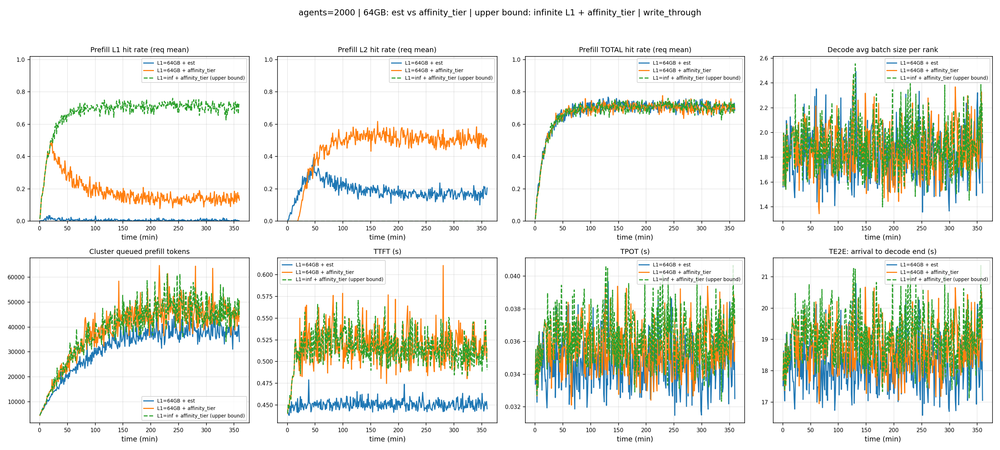
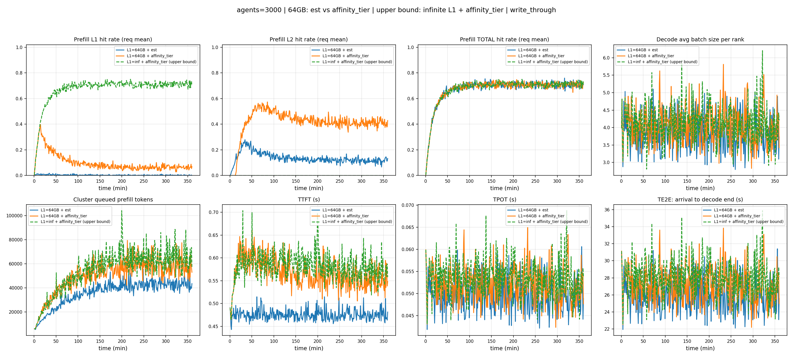
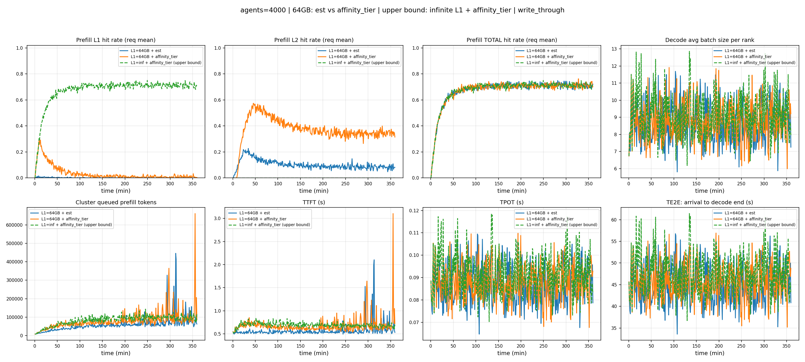
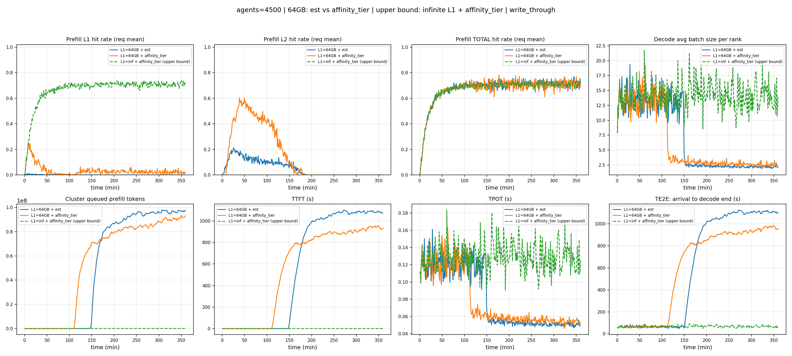
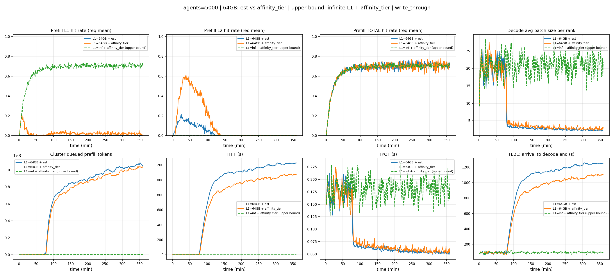

# 多级 KVcache 用户规模扫描实验报告

## 1. 实验目的

在其他条件不变的情况下，扫描并发用户数 **2000、3000、4000、4500、5000**，比较以下三组配置：

1. **64 GB L1 + `est`**：以最小预估 TTFT 为主进行调度；
2. **64 GB L1 + `affinity_tier`**：按 L1、L2、L3 的层级顺序优先保持 KV 亲和性，并列时按 `est` 打散；
3. **无限 L1 + `affinity_tier`**：理论最高命中率对照组。L1 不因容量不足而淘汰，配合亲和调度，使可复用历史尽可能留在原 rank 的 L1。

每组实验运行 6 小时。每个用户规模输出一张 2×4 八面板图，依次展示 L1 命中率、L2 命中率、总命中率、decode batch size、排队 prefill token、TTFT、TPOT 和 TE2E。

## 2. 实验配置

### 2.1 集群与缓存

| 参数 | 配置 |
|---|---:|
| 机器数 | 4 |
| 每机 NPU / DP rank 数 | 8 |
| 集群 NPU 总数 | 32 |
| L1 | 每 rank 64 GB；理论组为无限大 |
| L2 | 每机共享 2 TB |
| L3 | 全局共享 256 TB |
| KVcache 大小 | 105 KiB/token |
| 缓存块粒度 | 256 token，仅缓存完整 chunk |
| 写策略 | `write_through`，新 chunk 写入 L1/L2/L3 并去重 |

### 2.2 计算与调度

| 参数 | 配置 |
|---|---:|
| Prefill 并行方式 | TP8 / EP8，整机处理一条请求 |
| Decode 并行方式 | DP8 / EP8，每 rank 独立 batch，机内同步 |
| Chunked prefill | 每步最多 8192 token |
| Prefill 吞吐 | 每机 10000 token/s，仅计算 miss 部分 |
| Decode batch 上限 | 每 rank 32 |
| Decode ITL | 按实测点进行分段线性插值 |
| MTP 输出概率 | 1/2/3/4 token 分别为 0.50/0.25/0.15/0.10 |
| Continuous batching | 不开启；prefill 期间 decode 暂停 |
| 随机种子 | 42 |

### 2.3 负载模型

| 参数 | 配置 |
|---|---:|
| 仿真时长 | 6 小时 |
| 用户数 | 2000 / 3000 / 4000 / 4500 / 5000 |
| 用户补充机制 | 开启；达到轮数上限后以新身份重新进场，历史清零 |
| 每用户轮数 | 几何分布，均值 8，最大 32 |
| 每轮新增 prefill 长度 | 泊松分布，均值 4096 token |
| 每轮 decode 长度 | 泊松分布，均值 512 token |
| 首轮及轮间思考时间 | 指数分布，均值 600 s |
| 时间序列聚合 | 60 s/桶 |

## 3. 指标口径

- **命中率**：汇总表采用 token 加权命中率；图中采用每分钟请求命中率的均值。
- **总命中率**：L1、L2、L3 命中率之和。理论组也不是 100%，因为新用户、新增内容和不足一个完整 chunk 的尾部存在不可避免 miss。
- **TTFT**：从用户发起请求到全部 prefill chunk 完成，包含排队和 prefill 计算。
- **TPOT**：decode 阶段平均每输出一个 token 的时间。
- **TE2E**：从请求到达并开始排队，到该请求 decode 结束的端到端时延，包含 TTFT 和完整 decode 阶段。
- **Decode batch size**：每 rank 的平均 decode batch size。
- **最后 1 小时指标**：300–360 min 的分钟桶算术平均，忽略无样本桶。它用于识别后半程失稳，不能与全程请求分位数混用。

## 4. 核心结论

1. **2000–4000 用户时，三组总命中率都约为 85%，端到端性能处于同一量级。** `affinity_tier` 的主要作用是把命中从全局 L3 上移至本机 L2 和本卡 L1，而不是创造更多可复用前缀。
2. **64 GB 方案的稳定承载拐点位于 4000 与 4500 用户之间。** 4000 用户时三组基本完成约 13.3 万轮；4500 用户时，两组 64 GB 方案均出现排队失控，最后 1 小时 TTFT 均值约为 930–1082 s。
3. **无限 L1 对照组在 4500 和 5000 用户时仍保持稳定。** 其最后 1 小时 TTFT 均值分别约为 0.73 s 和 0.80 s，排队 token 没有持续增长，说明扩大驻留容量可以显著推迟本轮实验中的失稳点。
4. **高负载下不能简单用 TPOT 越低越好来解释。** 64 GB 组失稳后 decode batch 降到约 2–3，单步 ITL 因 batch 很小而较低；无限 L1 组维持 batch 14–21，TPOT 较高，但完成轮数更多且排队稳定，系统有效承载能力更强。
5. **`est` 的全程 TTFT p50 在高负载下具有误导性。** 例如 4500 用户时其 p50 仍为 0.76 s，但 p90 已达 1078.40 s；原因是大量早期正常请求拉低了中位数，必须结合 p90、排队曲线和最后 1 小时指标判断。

## 5. 全程汇总结果

命中率列为 token 加权的 L1/L2/L3 构成；TTFT 列为 p50/p90。

| 用户数 | 配置 | 完成轮数 | L1/L2/L3 命中 | 总命中 | Decode bs | TTFT p50/p90 (s) | TPOT mean (s) |
|---:|---|---:|---:|---:|---:|---:|---:|
| 2000 | 64 GB + `est` | 69935 | 0.7/23.3/61.6% | 85.6% | 1.81 | 0.44/0.47 | 0.035 |
| 2000 | 64 GB + `affinity_tier` | 69929 | 20.6/60.2/4.6% | 85.4% | 1.85 | 0.45/0.76 | 0.036 |
| 2000 | 无限 L1 + `affinity_tier` | 70121 | 85.5/0.0/0.0% | 85.5% | 1.89 | 0.45/0.76 | 0.036 |
| 3000 | 64 GB + `est` | 102711 | 0.3/16.7/68.3% | 85.4% | 3.81 | 0.45/0.58 | 0.050 |
| 3000 | 64 GB + `affinity_tier` | 103815 | 10.2/52.6/22.5% | 85.4% | 4.02 | 0.46/0.84 | 0.052 |
| 3000 | 无限 L1 + `affinity_tier` | 102742 | 85.5/0.0/0.0% | 85.5% | 4.09 | 0.46/0.86 | 0.054 |
| 4000 | 64 GB + `est` | 133671 | 0.1/12.3/73.0% | 85.3% | 8.64 | 0.47/0.80 | 0.087 |
| 4000 | 64 GB + `affinity_tier` | 133647 | 2.7/46.1/36.5% | 85.2% | 8.74 | 0.50/1.04 | 0.088 |
| 4000 | 无限 L1 + `affinity_tier` | 133320 | 85.4/0.0/0.0% | 85.4% | 9.11 | 0.57/1.12 | 0.092 |
| 4500 | 64 GB + `est` | 94647 | 0.1/8.0/75.0% | 83.0% | 4.67 | 0.76/1078.40 | 0.096 |
| 4500 | 64 GB + `affinity_tier` | 90413 | 3.9/23.2/55.5% | 82.7% | 4.48 | 7.00/918.77 | 0.090 |
| 4500 | 无限 L1 + `affinity_tier` | 146031 | 85.0/0.0/0.0% | 85.0% | 14.05 | 0.66/1.24 | 0.130 |
| 5000 | 64 GB + `est` | 81750 | 0.0/5.2/76.0% | 81.2% | 4.19 | 931.99/1206.55 | 0.106 |
| 5000 | 64 GB + `affinity_tier` | 86917 | 3.0/17.4/61.2% | 81.6% | 4.68 | 806.68/1047.97 | 0.106 |
| 5000 | 无限 L1 + `affinity_tier` | 154535 | 84.7/0.0/0.0% | 84.7% | 21.01 | 0.73/1.39 | 0.182 |

> 4500 和 5000 用户的有限 L1 组存在大量未完成排队请求，其命中率与 TPOT 只统计已执行/已完成请求，存在幸存者偏差，不宜与稳定组直接作同口径的效率优劣判断。

## 6. 最后 1 小时指标

| 用户数 | 配置 | TTFT mean (s) | TPOT mean (s) | Decode bs | 排队 prefill token |
|---:|---|---:|---:|---:|---:|
| 2000 | 64 GB + `est` | 0.45 | 0.035 | 1.83 | 38360 |
| 2000 | 64 GB + `affinity_tier` | 0.52 | 0.036 | 1.90 | 45556 |
| 2000 | 无限 L1 + `affinity_tier` | 0.51 | 0.036 | 1.90 | 45588 |
| 3000 | 64 GB + `est` | 0.48 | 0.049 | 3.78 | 43152 |
| 3000 | 64 GB + `affinity_tier` | 0.55 | 0.051 | 3.95 | 57520 |
| 3000 | 无限 L1 + `affinity_tier` | 0.57 | 0.053 | 4.07 | 65405 |
| 4000 | 64 GB + `est` | 0.69 | 0.089 | 9.03 | 100213 |
| 4000 | 64 GB + `affinity_tier` | 0.74 | 0.088 | 8.81 | 111149 |
| 4000 | 无限 L1 + `affinity_tier` | 0.67 | 0.092 | 9.25 | 97099 |
| 4500 | 64 GB + `est` | 1081.99 | 0.051 | 2.17 | 96506447 |
| 4500 | 64 GB + `affinity_tier` | 929.87 | 0.054 | 2.50 | 90307537 |
| 4500 | 无限 L1 + `affinity_tier` | 0.73 | 0.129 | 14.15 | 117576 |
| 5000 | 64 GB + `est` | 1218.46 | 0.053 | 2.33 | 104450122 |
| 5000 | 64 GB + `affinity_tier` | 1060.96 | 0.056 | 2.66 | 101015158 |
| 5000 | 无限 L1 + `affinity_tier` | 0.80 | 0.182 | 21.11 | 140090 |

## 7. 分用户规模结果

### 7.1 2000 用户



- 三组均稳定，TTFT p50 约 0.44–0.45 s，完成轮数约 7 万。
- `affinity_tier` 将 L1/L2/L3 命中构成从 `est` 的 0.7%/23.3%/61.6% 改为 20.6%/60.2%/4.6%，显著减少对全局 L3 的依赖。
- 总命中率并未提高，说明低负载下主要收益是**命中本地化**，而不是额外复用。
- Decode batch 约 1.8–1.9，仍属于较低 batch 工作点。

### 7.2 3000 用户



- 三组仍保持稳定，TTFT p50 约 0.45–0.46 s。
- 64 GB + `affinity_tier` 的 L1 命中降至 10.2%，L2 命中为 52.6%；用户工作集增大后，有限 L1 已无法保留全部历史。
- `est` 的 p90 TTFT 更低，说明亲和调度牺牲了部分负载均衡；当前模型未计层间传输时延，因此命中本地化尚未转化为 TTFT 收益。
- Decode batch 约 3.8–4.1。

### 7.3 4000 用户



- 三组在 6 小时内基本完成约 13.3 万轮，未出现持续队列崩溃，但后段存在短时排队尖峰。
- 64 GB + `affinity_tier` 的 L1 命中仅 2.7%，L2 命中升至 46.1%；有限 L1 的亲和收益进一步受到容量约束。
- 无限 L1 对照组保持 85.4% 总命中且全部落在 L1，说明此时理论组的差距主要在驻留容量，而非负载本身可复用性变化。
- Decode batch 约 8.6–9.1，已进入较合理的 decode batch 区间。

### 7.4 4500 用户



- 两组 64 GB 配置均在后半程失稳：排队 token 持续增长，decode batch 降至约 2–3，最后 1 小时 TTFT 均值达到 929.87 s 和 1081.99 s。
- `est` 的全程 p50 只有 0.76 s，是因为前期正常样本占比较高；其 p90 已达 1078.40 s，不能据此判断系统稳定。
- 无限 L1 对照组完成 146031 轮，比两组有限 L1 分别多约 54% 和 62%；最后 1 小时 TTFT 均值仅 0.73 s，decode batch 为 14.15。
- 该点直接说明：**当有限 HBM 的驻留 KV 挤占缓存与准入空间后，仅改变调度亲和性无法替代容量扩展。**

### 7.5 5000 用户



- 两组 64 GB 配置均持续长排队，全程 TTFT p50 已达 806.68–931.99 s；最后 1 小时排队 token 超过 1 亿。
- 无限 L1 对照组仍完成 154535 轮，约为两组有限 L1 的 1.78–1.89 倍；最后 1 小时 TTFT 均值为 0.80 s，排队保持低位。
- 理论组 decode batch 达 21.11，TPOT 均值升至 0.182 s，反映 decode 计算负担加重；有限组较低 TPOT 则主要来自 batch 崩溃后的低负载，并不代表更高系统吞吐。
- 在当前的 6 小时观察窗口内，无限 L1 组于 5000 用户仍稳定，但本实验不能据此推断其更高负载下的最终容量上限。

## 8. 综合分析

### 8.1 总命中率与命中层级是两个不同问题

在 2000–4000 用户的稳定区，总命中率基本由负载历史、新增 token 和全局 L3 决定，三种配置都约为 85%。`affinity_tier` 改变的是**在哪里命中**：

- `est`：请求会在 rank 间迁移，历史前缀更多由 L2/L3 补中；
- 有限 L1 + `affinity_tier`：提高本地命中，但容量压力会使用户数越高时 L1 收益越受限；
- 无限 L1 + `affinity_tier`：历史不因容量被淘汰，且请求回到原 rank，因此所有可复用历史均命中 L1。

在真实系统中，L1/L2/L3 的读取带宽和时延不同，命中本地化可能带来收益；但当前仿真将层间 promote/demote 视为瞬时完成，所以本实验不能量化这部分真实收益。

### 8.2 容量扩展的主要价值在高负载稳定性

4000 用户以下，无限 L1 没有显著改善 TTFT 或完成轮数；4500 用户以后，两组有限 L1 配置发生驻留空间不足、decode 准入受阻和 prefill 排队互相强化的失稳，而无限 L1 仍能维持正常准入与较高 decode batch。

因此，本组实验支持的结论不是“无限缓存让所有请求都快很多”，而是：

> **当系统接近容量—算力耦合的失稳区时，扩大可驻留 KV 容量能够显著提高稳定承载能力；在远离失稳区时，其主要收益表现为缓存命中本地化。**

### 8.3 当前仿真的解释边界

- L1/L2/L3 传输时延和带宽成本未建模，不能据此比较真实 HBM、DRAM、ASU/SSD 的命中时延。
- 连续前缀命中采用 per-agent chunk 计数近似，没有显式构造 LRU 空洞。
- 不开启 continuous batching，prefill 绝对优先，真实 serving 调度器可能表现不同。
- 无限 L1 是容量上界抽象，不代表真实硬件可无限扩展；其价值是分离“容量淘汰/驻留限制”与“负载本身没有复用机会”两类因素。
- 高负载失稳组只统计已处理请求，整体均值和命中率存在样本选择偏差，稳态判断以时间序列和最后 1 小时指标为主。

## 9. 复现方式与数据文件

在 `prefix_sim` 目录执行：

```bash
python compare_inf.py --agents 2000 --out out_user_sweep/users_2000
python compare_inf.py --agents 3000 --out out_user_sweep/users_3000
python compare_inf.py --agents 4000 --out out_user_sweep/users_4000
python compare_inf.py --agents 4500 --out out_user_sweep/users_4500
python compare_inf.py --agents 5000 --out out_user_sweep/users_5000
python summarize_user_sweep.py
```

`compare_inf.py` 会检查历史结果的完整配置，只有配置一致时才复用，否则重新运行。每组目录包含 `summary.json`、`series.json` 和 `metrics.png`；五档汇总数据见 [metrics_summary.csv](metrics_summary.csv)。
